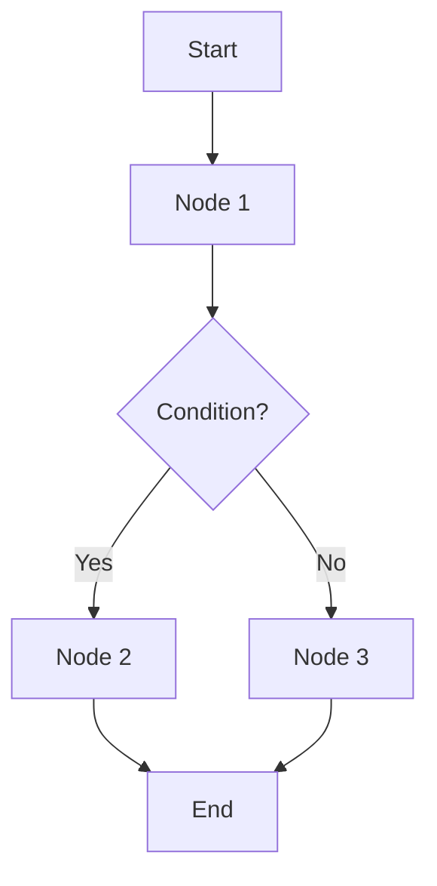

# Skill: Generate Workflow Docs

## Purpose
Generate complete, structured documentation of n8n workflows including description, nodes, flow, inputs/outputs, and configuration.

## When to Use
- To document new workflows
- To update existing workflow documentation
- Before modifying a workflow (for reference)
- For team onboarding
- For architecture auditing

## Execution Flow

### 1. Get Workflow Name

### 2. Get Complete Workflow using n8n-MCP

Collect:
- Workflow metadata (name, ID, description, tags)
- All nodes with complete configuration
- Connections between nodes
- Referenced credentials (names, not values)
- Environment variables used
- Triggers and webhooks

### 3. Delegate to `/n8n-node-config` for Details

For each node, get: type, version, parameters, operations, expressions.

### 4. Analyze and Extract Information

#### A. General Description and Purpose
What does this workflow do? What's its role in the AI agent system?

#### B. Nodes
For each: name, type, configuration, operation, expressions, credentials.

#### C. Execution Flow
Data flow between nodes, decisions (IF, Switch), error handling, loops.

#### D. Expected Inputs
What data does the workflow need? Format? Source (webhook, trigger, manual, other workflow)?

#### E. Generated Outputs
What does the workflow produce? Format? Destination (DB, API, other workflow, messaging channel)?

#### F. Connections with Other Workflows
What calls this workflow? What does this workflow call?

#### G. Required Credentials
List credential names and types (never values).

#### H. Environment Variables
What .env variables are used? Expected values (without real values).

### 5. Generate Flow Diagram (Mermaid)



### 6. Generate Markdown Documentation

Create file: `/docs/workflows/${WORKFLOW_NAME}.md`

Sections:
- Metadata (ID, type, status, dates, tags)
- General description
- Purpose in the AI agent system
- Mermaid flow diagram
- All nodes with detailed configuration
- Step-by-step execution flow
- Error handling and loops
- Inputs (trigger, expected data, source)
- Outputs (data, destination)
- Dependencies (related workflows, external integrations, database tables)
- Configuration (credentials, environment variables)
- Business-specific aspects (prompts, qualification logic, product references)
- Performance and limits (timeouts, rate limits)
- Testing (suggested test cases, test data)
- Troubleshooting (common errors, logs)
- Change history (link to changelog)

### 7. Present Summary

```
Workflow documentation generated

**Workflow:** ${WORKFLOW_NAME}
**Nodes documented:** ${TOTAL}
**Type:** ${TYPE}

**Documentation:** /docs/workflows/${WORKFLOW_NAME}.md

**Includes:** description, ${TOTAL} nodes with config, Mermaid diagram,
inputs/outputs, dependencies, credentials, business-specific aspects,
test cases, troubleshooting
```

## Documentation Types by Workflow Complexity

- **Simple (< 5 nodes):** Concise with linear flow
- **Complex (> 10 nodes):** Detailed with diagrams and extra sections
- **Main Agent:** Include prompt analysis, tone, product knowledge
- **Tool Workflows:** Focus on inputs/outputs and main agent integration

## Notes
- Documentation generated automatically but may need manual adjustments
- Mermaid diagrams may need simplification for very complex workflows
- NEVER expose credential values, only names and types
- Update documentation after important modifications
- Useful as reference before modifying workflows
- Facilitates team onboarding
