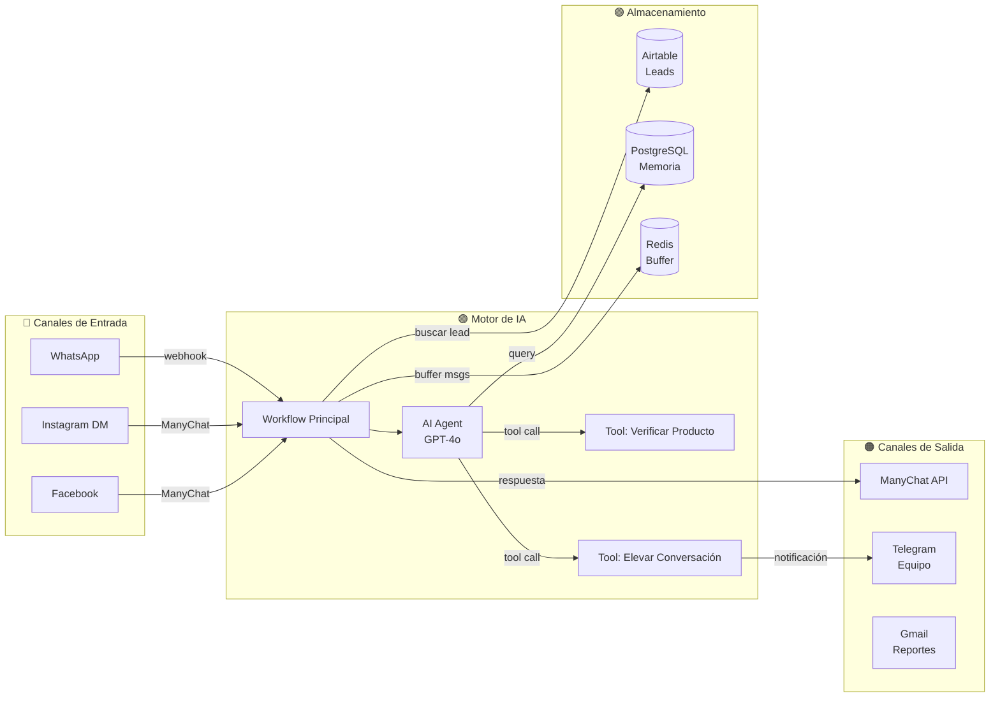
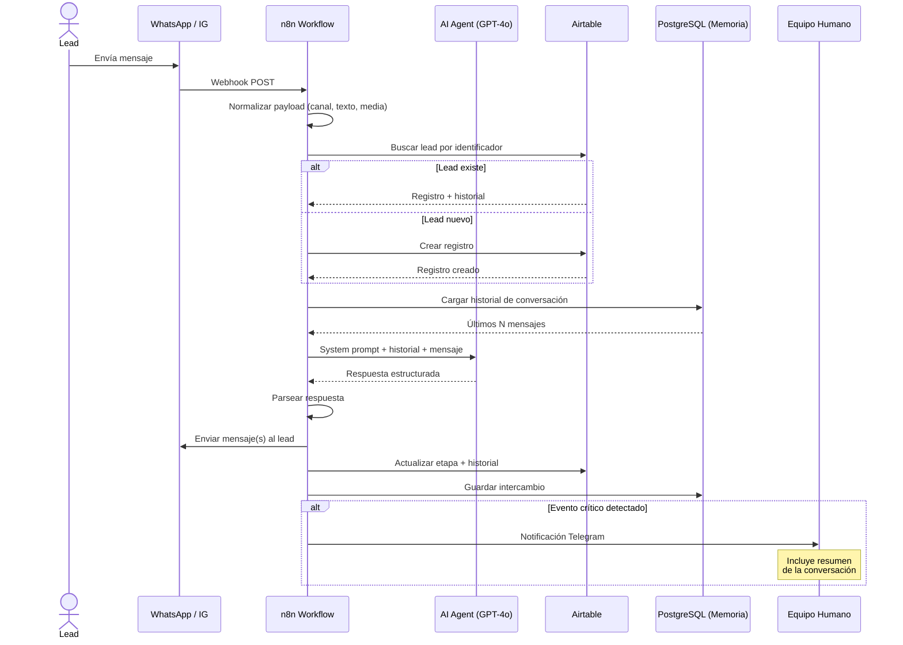
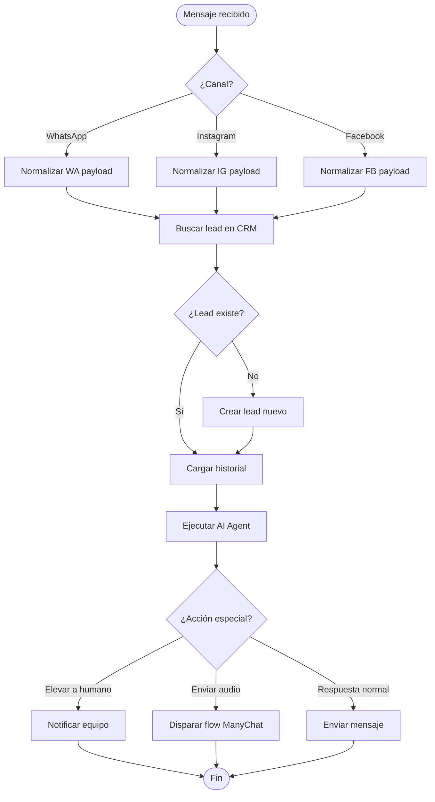
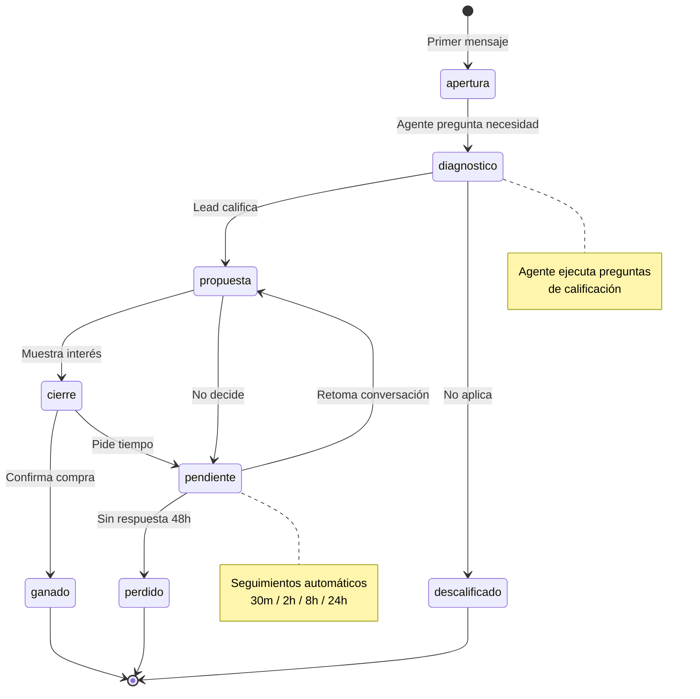
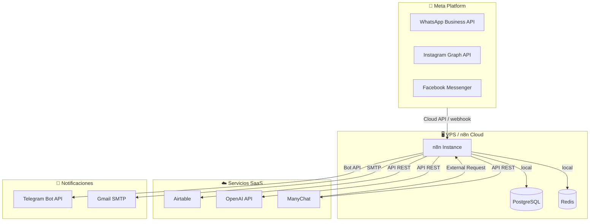

# Mermaid UML — Sintaxis, Patrones y Extracción

Referencia técnica para el skill `generar-uml`. Cargar antes de generar cualquier diagrama.

---

## A. Patrones de Sintaxis por Tipo de Diagrama

### 1. Componentes (`graph LR`)

Muestra qué piezas tiene el sistema y cómo se conectan.



**Reglas de construcción:**
- Dirección: `LR` (izquierda a derecha) — refleja el flujo de datos
- Subgraphs: agrupar por rol funcional (Canales, Motor, Data, Salida)
- Nodos con `[(  )]` para bases de datos, `[  ]` para servicios
- Usar `<br/>` para segunda línea (modelo, tipo de dato, etc.)
- Aristas etiquetadas con el protocolo o tipo de conexión ("webhook", "API REST", "tool call")
- Emojis en títulos de subgraph para distinción visual rápida

### 2. Secuencia (`sequenceDiagram`)

Muestra cómo fluye un request típico paso a paso.



**Reglas de construcción:**
- Participants: usar alias descriptivos (`participant AI as AI Agent (GPT-4o)`)
- Actor: solo para el usuario humano externo (`actor Lead`)
- `alt`/`else`: para bifurcaciones clave (lead existe vs. nuevo, evento crítico vs. normal)
- `loop`: para patrones de reintento o seguimiento
- `Note over X`: para contexto que no es un mensaje (timing, condiciones, datos)
- Flechas sólidas (`->>`) para requests, punteadas (`-->>`) para responses
- Un diagrama por journey distinto — no mezclar flujo principal con seguimientos

### 3. Actividad (`flowchart TD`)

Muestra la lógica de decisión dentro de un workflow.



**Reglas de construcción:**
- Dirección: `TD` (arriba hacia abajo)
- `([  ])` para inicio/fin (bordes redondeados)
- `{  }` para decisiones (rombo)
- `[  ]` para acciones
- Colapsar lógica interna de n8n — mostrar decisiones de negocio, no nodos técnicos
- Máximo 2 niveles de profundidad en bifurcaciones

### 4. Estado (`stateDiagram-v2`)

Muestra el ciclo de vida de una entidad (lead, ticket, pedido).



**Reglas de construcción:**
- `[*]` para estado inicial y final
- Transiciones etiquetadas con el evento que las causa
- `note right of X`: para aclarar qué actor o automatización opera en ese estado
- Extraer estados de: campo `Single select` en Airtable, o etapas mencionadas en system prompts
- No incluir estados técnicos internos (ej. "procesando webhook") — solo estados de negocio

### 5. Despliegue (`graph TB`)

Muestra dónde corre cada componente del sistema.



**Reglas de construcción:**
- Dirección: `TB` (arriba hacia abajo)
- Subgraphs por capa de infraestructura
- Etiquetar aristas con protocolo de conexión
- Incluir si la conexión es local vs. remota
- No incluir secretos ni URLs reales

---

## B. Buenas Prácticas para Handoff

### Nivel de abstracción correcto
- Colapsar routing interno de n8n (6 nodos if/switch para detectar canal) en una sola arista etiquetada "webhook por canal"
- Mostrar sub-workflows como un solo nodo "Tool: [Nombre]", no sus nodos internos
- Si un workflow tiene >20 nodos, dividir en diagrama general (componentes) + diagramas de detalle (secuencia por journey)

### Nombrar por función
- "Buffer de mensajes" no "Redis Wait_35"
- "Motor de IA" no "@n8n/n8n-nodes-langchain.agent"
- "CRM Leads" no "Airtable node [AIRTABLE_TABLE_ID]"
- El freelancer necesita entender QUÉ hace cada pieza, no CÓMO se llama internamente

### Credenciales
- Listar tipo de credencial (ej. "openAiApi", "airtableTokenApi") en la tabla de stack
- Nunca incluir tokens, API keys, base IDs, ni URLs de webhook
- Si hay credenciales compartidas entre workflows, mencionarlo

### Puntos frágiles
- Revisar campo `notes` de nodos n8n — a menudo documentan workarounds o bugs conocidos
- Revisar sticky notes del workflow — documentación del builder original
- Revisar "Pendientes técnicos" en CLIENT_INFO.md o CLAUDE.md
- Marcar en el diagrama con `Note over` o comentario `%%`

### Timing y delays
- Si hay nodos Wait/Delay, incluir duración en el diagrama
- Si hay seguimientos automáticos, mostrar los intervalos (30m, 2h, 8h, 24h)
- Si hay rate limiting (Redis buffer, anti-spam), mencionarlo

### Scope por diagrama
- 1 diagrama de secuencia por journey principal (no mezclar flujo de ventas con seguimiento con reporte semanal)
- Si hay >3 journeys, listarlos y preguntar al usuario cuáles priorizar
- Máximo 15-20 nodos por diagrama — la claridad gana a la exhaustividad

---

## C. Patrones de Extracción por Stack

### n8n Workflow JSON

**Estructura de un nodo:**
```json
{
  "name": "AI Agent",
  "type": "@n8n/n8n-nodes-langchain.agent",
  "parameters": {
    "text": "={{ $json.mensaje }}",
    "options": { "systemMessage": "..." }
  },
  "credentials": {
    "openAiApi": { "id": "xxx", "name": "OpenAI" }
  },
  "notes": "Usa gpt-4o, temperature 0.7",
  "position": [800, 300]
}
```

**Estructura de conexiones:**
```json
{
  "NodoOrigen": {
    "main": [[
      { "node": "NodoDestino", "type": "main", "index": 0 }
    ]]
  }
}
```

**Clasificación de nodos por tipo:**

| Patrón en `type` | Categoría | Rol en diagrama |
|-------------------|-----------|-----------------|
| `trigger`, `webhook` | Trigger | Punto de entrada |
| `langchain` | AI/Agent | Cerebro del sistema |
| `airtable`, `postgres`, `redis`, `googleSheets`, `notion` | Data Store | Persistencia |
| `telegram`, `slack` | Messaging | Canal de salida |
| `httpRequest` (a ManyChat/WA/APIs) | Integración | Conexión externa |
| `if`, `switch`, `code`, `set`, `merge` | Lógica | Routing/transformación |
| `wait` | Delay | Timing (incluir duración) |
| `executeWorkflow`, `toolWorkflow` | Sub-workflow | Operación delegada |
| `stickyNote` | Documentación | Leer `parameters.content` |

**Datos clave a extraer de toolWorkflow:**
- `parameters.description` → propósito del tool (lo que ve el AI Agent)
- `parameters.workflowId.cachedResultName` → nombre del sub-workflow

**Datos clave a extraer de webhook/trigger:**
- `parameters.path` → endpoint expuesto
- `parameters.httpMethod` → método HTTP

### System Prompts (.md)

Buscar en los archivos de `04_agents/`:

| Patrón | Qué revela | Ejemplo |
|--------|-----------|---------|
| Declaración de rol | Función del agente | "Sos el asistente de ventas de..." |
| Lista de productos/servicios | Catálogo | Precios, nombres, condiciones |
| `{{VARIABLE}}` | Datos inyectados desde n8n | `{{HISTORIAL}}`, `{{CANAL}}`, `{{ORIGEN}}` |
| Tools mencionados | Sub-workflows disponibles | "Tenés la herramienta verificar_producto" |
| Reglas SIEMPRE/NUNCA | Restricciones críticas | "NUNCA inventes precios" |
| Etapas o fases | Pipeline del agente | apertura → diagnóstico → propuesta → cierre |
| Reglas de escalamiento | Cuándo interviene un humano | "Si el lead pide hablar con alguien..." |

### Airtable/CRM Schemas (.md en `05_crm/`)

| Qué buscar | Para qué diagrama |
|------------|-------------------|
| Nombres de tablas | Componentes (cada tabla es un data store) |
| Campos `Single select` | Estado (los valores son estados del pipeline) |
| Campos `Link to another record` | Componentes (relaciones entre tablas) |
| Campos `Formula`/`Rollup` | Actividad (cálculos automáticos) |
| Vistas con filtros | Actividad (segmentación de datos) |

### CLIENT_INFO.md

| Sección | Qué extraer |
|---------|-------------|
| Stack activo | Lista de servicios → nodos del diagrama de Componentes |
| OKRs | Propósito del sistema → "Qué es este sistema" |
| Contactos | Tabla de contactos para el freelancer |
| Notas críticas | Puntos frágiles y pendientes |
| Status | Fase actual del proyecto |
