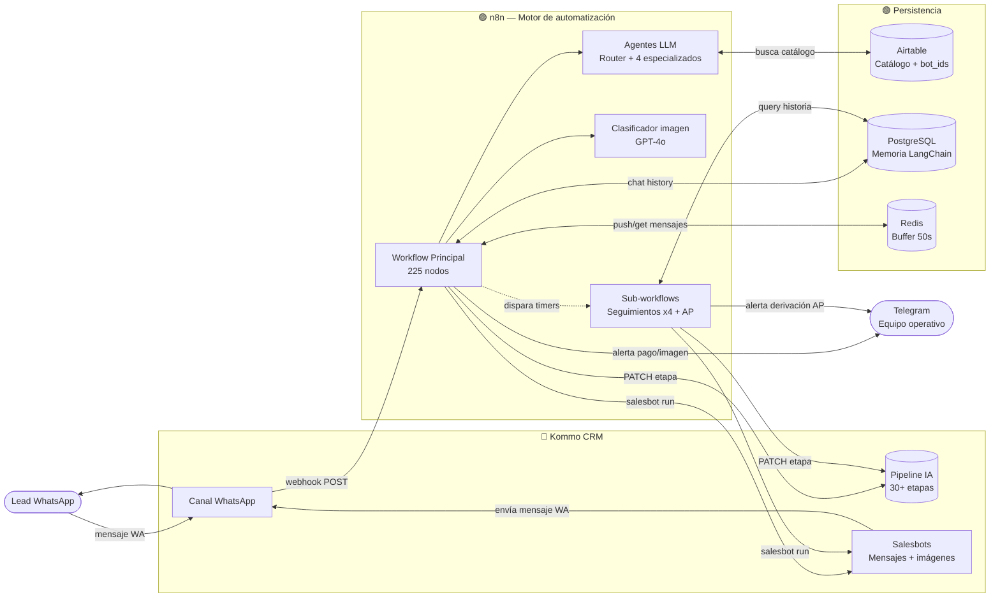
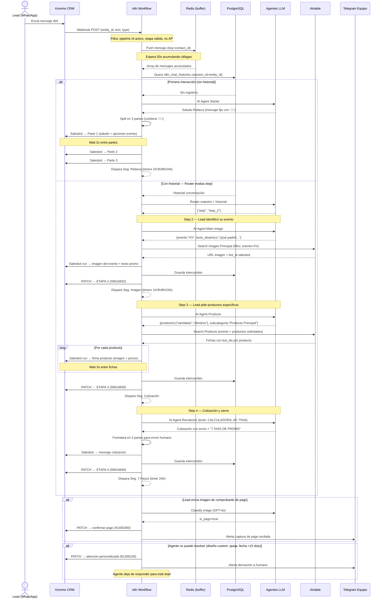
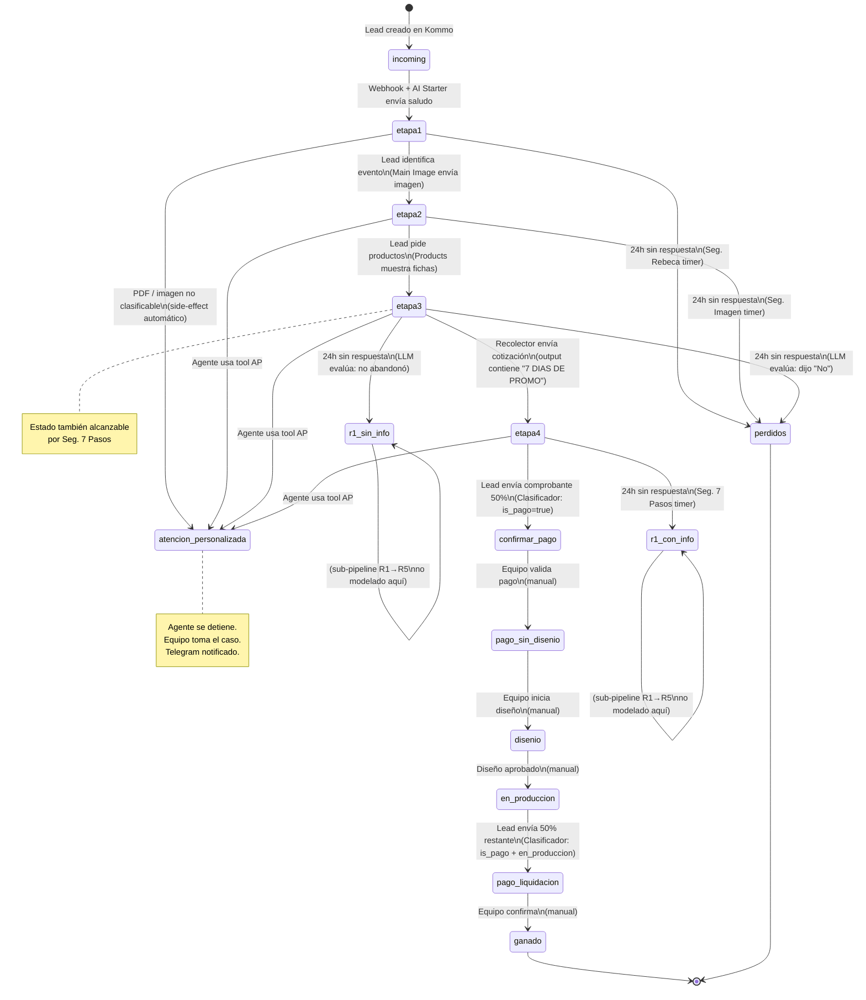

# Documentación UML — Happy Flops

> Generado: 2026-05-14 | Proyecto: Agente conversacional de ventas "Rebeca" para sandalias e insumos para fiestas y eventos
> Stack: n8n, Kommo CRM, OpenAI GPT-4o/4.1-mini/Whisper, Airtable, PostgreSQL, Redis, Telegram

---

## Referencia Rápida para el Freelancer

### Qué es este sistema

Happy Flops opera un agente conversacional llamado **Rebeca** que atiende clientes por WhatsApp. El agente sigue un proceso de venta de 4 pasos (saludo → imagen del evento → fichas de productos → cotización/cierre), gestionado por un Router que decide qué agente especializado responde según el historial de la conversación. Todo el estado del lead vive en el CRM Kommo; los mensajes se envían via salesbots de Kommo, no directamente a WhatsApp.

### Stack tecnológico

| Servicio | Función | Credencial requerida |
|----------|---------|---------------------|
| n8n | Orquestador central. 225 nodos + 5 sub-workflows | — (self-hosted o n8n cloud) |
| Kommo CRM (AmoCRM) | Canal WhatsApp, estado del lead (pipeline), envío de mensajes vía salesbots | `kommoApi` |
| OpenAI | 6 agentes LLM: Router, Starter, Main Image, Products, Recolector, Clasificador | `openAiApi` |
| Airtable | Catálogo de productos con imágenes, precios y bot_ids de salesbots | `airtableTokenApi` |
| PostgreSQL | Memoria conversacional LangChain (`n8n_chat_histories`), tracking seguimientos | `postgres` |
| Redis | Buffer anti-ráfaga: acumula mensajes en ráfaga 15-50s antes de procesar | `redis` |
| Telegram | Notificaciones operativas al equipo (pagos, derivaciones, imágenes no clasificables) | `telegramBotApi` |

### Workflows activos

| Workflow | Trigger | Función principal |
|----------|---------|-------------------|
| `happyflops-main-v2.json` | Webhook Kommo (POST al recibir mensaje WA) | Flujo principal: filtra, debounce, router, agente, envío |
| `happyflops-seg-rebeca-v1.json` | Llamado por main tras saludo | Re-engagement: 1h / 3h / 8h / 24h post-saludo |
| `happyflops-seg-imagen-v1.json` | Llamado tras enviar imagen del evento | Re-engagement: 1h / 3h / 8h / 24h post-ETAPA 2 |
| `happyflops-seg-cotizacion-v1.json` | Llamado tras mostrar productos | Re-engagement: 1h / 3h / 8h / 24h post-ETAPA 3; LLM evalúa si abandonó |
| `happyflops-seg-7pasos-v1.json` | Llamado tras enviar cotización completa | Re-engagement: 24h; promueve a R1 CON INFO |
| `happyflops-atencion-personalizada-v1.json` | Tool del Agente Recolector | Mueve lead a AP + notifica Telegram |

### Contactos

| Nombre | Rol | Contacto |
|--------|-----|----------|
| Oscar | Dueño | — |

---

## Diagrama de Componentes

Muestra las piezas del sistema y cómo se conectan. Kommo es tanto el punto de entrada (recibe mensajes WA y dispara webhooks) como de salida (n8n llama sus salesbots para enviar mensajes al lead).

### Notas del diagrama
- **Kommo como proxy de WhatsApp**: n8n nunca habla directamente con la API de WhatsApp. Kommo es el intermediario en ambas direcciones.
- **Salesbot ≠ n8n construye el mensaje**: los salesbots de Kommo ya tienen el contenido (imagen + texto) precargado. n8n solo dispara el salesbot por `bot_id`. Los `bot_ids` están en las tablas de Airtable.
- **Dos APIs Kommo**: `kommo.com/api/v4` (moderna, para mover etapas) y `amojo.kommo.com/v2` (legacy, para enviar mensajes). Ambas apuntan al mismo backend — AmoCRM es el rebrand anterior de Kommo.
- **Redis**: la clave de buffer es `contact_id` (numérico). Si dos mensajes llegan en ráfaga dentro de 50s, solo se procesa el último.
- **PostgreSQL**: `session_id` = `entity_id` del lead en Kommo. Todas las instancias de Postgres Chat Memory usan el mismo session_id, compartiendo historia.

---

## Diagrama de Secuencia — Journey Principal (lead nuevo → cotización)

Muestra el flujo completo desde que un lead nuevo escribe por primera vez hasta que recibe una cotización. El sistema detecta la primera interacción y escala el proceso en 4 pasos automáticos.

### Notas del diagrama
- **Debounce de 50s**: si el lead manda 3 mensajes seguidos en ráfaga, n8n espera 50s y procesa solo el último acumulado.
- **Mensajes en 3 partes**: los mensajes largos se dividen en 3 partes con waits de 2-3s entre ellas para simular escritura humana.
- **Fuera de horario (L-V 9:00–17:30 México)**: el sistema envía un mensaje diferente (tabla "Foto Vacaciones" en Airtable) y no procesa la conversación normalmente.
- **Audio**: si el lead manda audio, n8n lo transcribe con OpenAI Whisper antes de pasarlo al Router.
- **Imágenes de producto**: si el lead manda foto de un producto (ej. sandalias), el Clasificador la convierte en texto `"Te envio una imagen del producto: [nombre]"` y la pasa al Recolector1 (variante de imagen).

---

## Diagrama de Estado — Pipeline del Lead

Muestra el ciclo de vida completo de un lead en el pipeline IA de Kommo. Las transiciones automáticas (en azul conceptual) las gestiona n8n; las manuales las hace el equipo en el CRM.

### Notas del diagrama
- **Solo el pipeline `IA` (ID: 11622596)** es automatizado. Los otros 12 pipelines de Kommo (SANDALIAS BODAS, Cilindros, XV AÑOS, etc.) son manuales/legacy y el agente los ignora.
- **Sub-pipeline R1–R5**: después de `r1_sin_info`/`r1_con_info` existe un sub-pipeline de re-engagement de hasta 5 rondas (R1→R5) no documentado completamente en el código actual. Ver `00_migracion_ghl/01_logica_actual/03_maquina_estados.md` ítem 3.
- **Bloqueos del agente**: si el lead está en `atencion_personalizada`, `confirmar_pago`, cualquier etapa `Rn ap`, o `perdidos`, el agente no responde aunque lleguen mensajes nuevos.
- **Estados implícitos en memoria**: el `step` actual (1-4), el evento detectado (Boda/XV/Otros), productos mostrados, CP y cantidades viven en PostgreSQL. Kommo solo sabe la etapa, no estos detalles.

---

## Glosario Técnico

| Término | Significado |
|---------|-------------|
| Salesbot | Bot pre-configurado en Kommo que tiene cargados mensajes e imágenes. n8n lo dispara por `bot_id`; no construye el contenido. |
| `bot_id` | ID numérico del salesbot en Kommo. Está almacenado en Airtable junto a cada producto/imagen. |
| `entity_id` | ID del lead en Kommo. Es el identificador universal: se usa como `session_id` en PostgreSQL. |
| `contact_id` | ID del contacto en Kommo (diferente al lead). Se usa como key en Redis. |
| Pipeline IA | El único pipeline de Kommo donde opera el agente. ID: `11622596`. |
| AP | Atención Personalizada — etapa donde el humano tomó el caso. El agente no responde en esta etapa. |
| Anti-ráfaga / debounce | Mecanismo Redis que acumula mensajes en ráfaga (50s) y procesa solo el último, evitando respuestas múltiples. |
| Router maestro | Agente LLM que decide qué step (1-4) ejecutar en cada turno, leyendo el historial completo. |
| AmoCRM / Kommo | El mismo sistema. AmoCRM fue renombrado a Kommo. Las URLs `amocrm.com` y `kommo.com` apuntan al mismo backend. |
| `amojo.kommo.com` | API interna de Kommo para envío de mensajes directos (no salesbot). Requiere token de sesión. |
| LangChain Memory | Implementación de memoria conversacional de n8n usando PostgreSQL. Tabla: `n8n_chat_histories`. |
| `status_id` | ID de la etapa actual del lead en Kommo. La fuente de verdad del estado del funnel. |

## Archivos Clave del Proyecto

| Archivo | Qué contiene | Ruta |
|---------|-------------|------|
| Workflow principal | 225 nodos, flujo completo del agente | `03_workflows/happyflops-main-v2.json` |
| Mapa funcional | Reconstrucción completa de la lógica del sistema (leer primero) | `00_migracion_ghl/01_logica_actual/01_mapa_funcional.md` |
| Máquina de estados | Todas las transiciones del pipeline IA con IDs de Kommo | `00_migracion_ghl/01_logica_actual/03_maquina_estados.md` |
| Reglas de negocio | Reglas del Agente Recolector (cotización, upsell, restricciones) | `00_migracion_ghl/01_logica_actual/05_reglas_negocio.md` |
| Catálogo de mensajes | Mensajes fijos del agente con contexto de cuándo se usan | `00_migracion_ghl/01_logica_actual/04_catalogo_mensajes.md` |
| Seg. Rebeca | Sub-workflow re-engagement post-saludo | `03_workflows/happyflops-seg-rebeca-v1.json` |
| Seg. Cotización | Sub-workflow re-engagement con LLM evaluador | `03_workflows/happyflops-seg-cotizacion-v1.json` |
| Atención Personalizada | Sub-workflow de escalamiento a humano | `03_workflows/happyflops-atencion-personalizada-v1.json` |
| Fix primera interacción | Contexto del fix `SAVE_FIRST_MESSAGE` de 2026-05-04 | `CLIENT_INFO.md` (sección Fixes aplicados) |
| Reunión Oscar | Notas de la reunión más reciente con el cliente | `06_docs/reunion-oscar-2026-05-09.md` |
