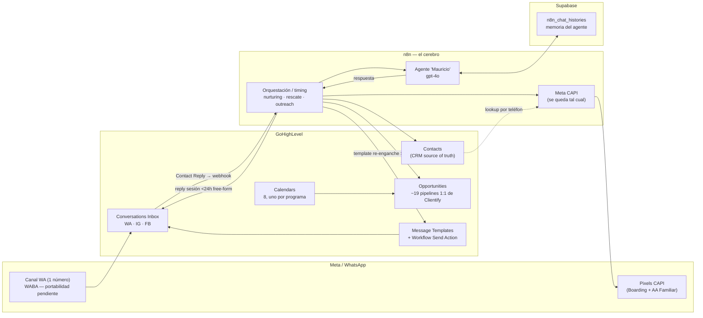

# 00 · Overview — Arquitectura destino Venttur (n8n + GHL)

> **Etapa 3 de la migración.** Diseño en papel. No se crea la cuenta GHL, no se toca n8n vivo, no se escribe código. Este documento es el índice y el marco; los mappings viven en `01`–`11`.
>
> **Fuente de verdad:** los 6 docs de `01_logica_actual/` (reescritos 2026-07-24, validados con Mauricio 2026-08-17) + las decisiones cerradas en `02_validacion_cliente/` (autoritativa: `puntos-abiertos-ronda-2-2026-08-18.md`). Toda afirmación de dato se corrobora contra el **sistema real** (`00_inputs/`: JSON de workflows, CSVs de Airtable, snapshot Clientify/ManyChat), no contra la prosa de los docs.

---

## 1. Método (no negociable)

Traducción **quirúrgica**, no rediseño. Es la 2ª forma de HPF (la 1ª, interpretativa, se descartó entera). Reglas:

1. **1:1, tabla por tabla / flow por flow / campo por campo.** Cada elemento del sistema actual tiene un equivalente en el stack destino y se documenta cuál.
2. **Ajustar solo al formato de la herramienta destino.** No mejorar la lógica, no "hacerlo más elegante en GHL".
3. **No simplificar** salvo lo (a) duplicado, (b) muerto (sin ejecución hoy) o (c) verdaderamente innecesario — y siempre con **argumento explícito** (ver §6, Registro de descartes). Ante la duda, replicar tal cual. Es preferible un flujo "sobrediseñado" para GHL a uno simplificado que rompe un caso borde.
4. **Preferencia n8n.** Si algo puede vivir en n8n o en GHL, va a n8n (ahí vive la lógica hoy, ahí la agencia tiene más control y el debugging es previsible). GHL se usa **solo** por sus capacidades nativas: Conversations (canal WA/IG/FB), Contacts (CRM source of truth), Opportunities/pipelines, Calendars, Message Templates, Sites/Forms.
5. **Corroborar cada fila** contra el JSON/CSV/snapshot real antes de darla por buena.

---

## 2. Stack destino — qué vive dónde

| Capacidad | Vive en | Por qué |
|---|---|---|
| Canal WhatsApp/IG/FB, Inbox unificado | **GHL** (Conversations + LeadConnector) | Nativo; reemplaza ManyChat sin pérdida |
| CRM: contactos, tags, custom fields, owner | **GHL** (Contacts) | Source of truth único; hoy disperso en Clientify+Airtable+ManyChat |
| Pipelines comerciales / deals | **GHL** (Opportunities) | ~19 pipelines de Clientify se reconstruyen 1:1 (varios legacy/chicos) |
| Calendarios y agendamiento | **GHL** (Calendars) | Nativo; 8 calendarios, disponibilidad compartida por asesor |
| Reply conversacional del agente (dentro de la ventana 24h) | **GHL** (Conversations, mensaje de sesión free-form) | El LLM genera texto dinámico → NO es plantilla; se envía como sesión vía LeadConnector |
| Plantillas WhatsApp Meta (re-enganche fuera de la ventana 24h) | **GHL** (Message Templates + Workflow Send Action) | Se preservan **solo si la WABA migra por BSP**; toda plantilla ausente se re-crea y re-aprueba (24-72h) |
| Agente conversacional "Mauricio" | **n8n** (gpt-4o) | n8n-first; memoria + memoria sintética viven en Supabase (decisión N.2) |
| Orquestación, timing, condicionales, nurturing/rescate/outreach | **n8n** | n8n-first; el cliente pidió mudar la cadencia de ManyChat a n8n |
| Atribución Meta CAPI | **n8n + Airtable** | Se queda tal cual (SHA-256, lookups, Graph API). Ver `05` |
| Memoria conversacional del agente | **Supabase** | Sin cambios; el Contact de GHL no la reemplaza |
| **ManyChat** | **— (desaparece)** | Los 8 casilleros activos tienen equivalente exacto o superior en GHL |

---

## 3. Formato estándar de los mappings (metodología punto 3)

Cada doc `02`–`10` tiene como columna vertebral **una tabla de traducción, una fila por elemento del sistema actual**:

| Elemento actual (sistema · id) | Qué hace hoy | Equivalente n8n + GHL | Qué cambia en el formato | Nota / rareza |
|---|---|---|---|---|
| *ej: `ID Clientify` (Airtable Leads · col12)* | *FK 1:1 al contacto Clientify* | *no migra como campo — se resuelve en el merge de identidad* | *se descarta post-merge; queda `Contact.id` de GHL* | *solo 45% de leads lo tienen* |

- Un elemento que **se descarta** se marca en la fila y se argumenta en §6.
- Un elemento que **se queda en n8n** (no migra a GHL) se marca explícito (ej. tablas CAPI).
- Un **bug de origen** que se corrige de paso se marca `🔧 fix` (no es rediseño: es reparar lo que ya debía funcionar).

---

## 4. Índice de documentos

| # | Doc | Cubre | Riesgo |
|---|---|---|---|
| 00 | `00_overview.md` | Este doc: método, stack, formato, descartes, banderas | — |
| 01 | `01_taxonomia_programas.md` | Los 8 programas canónicos + normalización + remapeo de cohortes | Prerequisito |
| 02 | `02_datos_contactos_identidad.md` | Airtable Leads + Clientify Contacts + ManyChat subs → GHL Contacts | 🔴 #1 |
| 03 | `03_datos_pipeline_deals_estado.md` | ~19 pipelines Clientify + estado Airtable → GHL Opportunities | 🔴 #2 |
| 04 | `04_datos_campos_tags.md` | Custom fields + tags de los 3 sistemas → GHL | 🟡 |
| 05 | `05_datos_capi_atribucion.md` | Folios/Programas CAPI + Mensajes anuncios → **se quedan en n8n** | 🟡 |
| 06 | `06_canal_whatsapp_y_agente.md` | Canal WA, agente Mauricio, templates, handoff, 1 número | 🔴 #3 |
| 07 | `07_agendamiento_calendarios.md` | 8 calendarios, asesores, confirmación + recordatorios 24h/1h | 🟡 |
| 08 | `08_workflows_n8n.md` | Los 14 workflows → se-queda/reconstruye/descarta | 🟡 |
| 09 | `09_nurturing_rescate_reengagement.md` | Consolidación de cadencias, tope global 2 toques, política Cerrada | 🟡 |
| 10 | `10_programas_nuevos.md` | Los 3 huérfanos construidos de cero | 🟢 scope |
| 11 | `11_flujo_end_to_end.md` | Diagrama Mermaid del lead post-migración + narrativa | Síntesis |

**Orden de escritura (por riesgo, no por facilidad):** 01 (lock-in) → **02** → 03 → 06 → 08+09 → 07 → 10 → 05+04 → 11.

---

## 5. Cifras de referencia (corroboradas contra `00_inputs/`, 2026-08-26)

Números que anclan todos los mappings. Fuente entre paréntesis.

- **Airtable Leads:** 3.819 filas (`leads.csv`). FK `ID Clientify` presente en 1.730 (45,3%); `ID Manychat` en 2.907 (76,1%); **442 sin ninguna FK**. `id`=`id_2`=teléfono sin `+`, siempre iguales. Teléfono: 2.510 con prefijo `521` / 1.229 con `52` (el quirk MX, en los datos). Email solo 12,6% (482 ≈ cohorte Form Meta). `Estado conversación`: 3.628 vacío / 168 interrumpida / 13 cita confirmada / 10 contestó.
- **Clientify:** 6.968 contactos, **4.558 con teléfono** (2.410 sin) / 2.576 con email; **170 contactos con la variante 52/521 duplicada en el mismo registro** (`+5215…` **y** `+525…`). 2.338 deals en **~19 pipelines** distintos (varios legacy/chicos). 266 companies. 22 custom fields.
- **Solape por teléfono canónico (colapsando 521→52):** Airtable 3.462 únicos · Clientify ≈4.558 únicos · **intersección 1.855** · solo-Airtable 1.607 · solo-Clientify ≈2.703. **Universo GHL Contacts ≈ 6.165 (por teléfono) + hasta 2.410 (Clientify sin teléfono) ≈ 8.575** (cotas ±2 por ~260 teléfonos malformados).
- **ManyChat:** 16–17 flows en 4 carpetas · 5 tags · 13 custom fields (`snapshot`).
- **CAPI:** Folios 4.003 filas (con folios repetidos, sin dedup) · Programas 4 (BS/BSG/BSC → pixel Boarding; HF → pixel AA Familiar).

---

## 6. Registro de descartes (lo único que NO se replica)

Solo lo (a) duplicado, (b) muerto o (c) innecesario, con evidencia. **Todo lo demás se replica tal cual.**

| Elemento | Tipo | Argumento / evidencia | Destino |
|---|---|---|---|
| Tool `contestan_2do` | muerto | Instruida en el prompt (línea 343) pero **sin nodo cableado** (fantasma). Descarte del código confirmado; **la baja de la métrica es propuesta de la agencia (A10, resuelta por omisión), pendiente de OK explícito del cliente** (ronda 2, 🟢). | Se elimina la instrucción del prompt v2.0 |
| Tag `wpp` (ManyChat) | muerto | Definido pero **no lo aplica ningún flow** (huérfano). | No migra |
| Tool `primer_registro` (`gyMROURqhLlYtJJU`) | muerto | `DISABLED` en el main; reemplazada por el nodo determinístico `Crear primer contacto`. | No migra |
| Rama 6ª "Estudio y Trabajo" en memoria de Rescate | muerto | El Code de envío mapea 5 destinos; el de memoria 6 → esa clave nunca llega a un lead (gate previo). Se fusiona con Gap Year (mismo programa VET). | Colapsa en Gap Year |
| Keyword triggers CTWA (ManyChat) | innecesario | El cliente separó **atribución** (automática, dato de Meta) de **conversación** (el agente siempre pregunta) → el mapeo keyword→programa deja de existir. | No se recrea |
| Orden del Switch de nurturing (Pathway>Summer>AA>Boarding>Gap) | innecesario | Multi-programa se resuelve por contexto (decisión cliente ronda-2, 2026-08-18); el orden queda deprecado por no tener criterio comercial deliberado (observación la agencia, `05` §7.2). | No se recrea |
| Valor `Activa` del enum `Estado conversación` | muerto | 0/3.819 leads lo tienen; el lead nuevo queda BLANK. | No migra como estado |
| Path de **Diego** en `wf-confirmacion-agenda` | muerto | Referencia nodos inexistentes (`Obtener ID Manychat2`) + Diego sale del ruteo (cliente). | Se **borra**, no se repara |
| Rama TRUE de `Repetido?` (main) | muerto | Rama muerta + comparador desalineado (latin1 vs UTF-8). | No se recrea; dedup se hace en n8n limpio |
| Triple-write (Airtable + Clientify + Supabase) | duplicado | Mismo lead en 3 sistemas con 3 identidades. GHL Contact unifica. | Se colapsa a 1 Contact GHL |
| Doble alta de contacto (determinística + agéntica) | duplicado | `Crear primer contacto` + tool `crear_contacto` se pueden pisar. | Una sola alta en GHL |
| `wf-seguimiento-agenda` (48h) vs Rescate (45min+24h) | duplicado (condicionado) | Dos mecanismos paralelos al mismo objetivo (link sin cita), en ventanas de timing distintas. La consolidación **depende del tope global de 2 toques** (bandera 4); si el cliente conserva más toques, cambia. | Se consolidan en `09` |
| Tabla Airtable "Tabla apoyo (ignorar)" | innecesario | El cliente indica que es descartable (ledger de dedup). | No migra; dedup vive en GHL/n8n |
| `wf-correo-semanal` (modo test) | se reconstruye | `active:false`, destinatario de prueba, "CORRER FLUJO MANUAL". | Reporting nativo GHL (`08`) |

> **Bugs que se CORRIGEN, no se descartan** (deben funcionar tras migrar): `Hay audios?` (condición imposible → la transcripción nunca corrió), confirmación de agenda (0/11 enviadas), gate `asesoria=='cero'` roto, `Agendan cita=true` escrito antes del envío, bug tag `.variable`, secretos hardcodeados (rotar).
>
> **Asimetría `Hay audios?` vs rama TRUE de `Repetido?`** (ambas nunca ejecutan hoy, tratamiento opuesto — se argumenta): la transcripción se **corrige** porque es una degradación viva del UX (una nota de voz llega al agente como string vacío), y se trata como **camino nuevo a construir + testear** (casos de audio en la guía de testing), no como "funciona tras migrar". La rama TRUE de `Repetido?` se **descarta** porque es código útil-nulo (el dedup se rehace limpio en n8n).

---

## 7. Banderas a resolver durante el mapping (no bloquean el diseño)

1. **Dos números en operación a consolidar:** ManyChat (agente: conversación + agenda) y **Clientify (recordatorios de cita, hoy fuera de los 14 workflows)**. La decisión "un solo número" los absorbe a ambos → los recordatorios se reconstruyen en GHL (`07`). El `+52 1 33 1944 2476` de Rodrigo **NO** es un canal a reconciliar: es un dato de negocio a preservar (`06` §F.3, KEEP), se comparte al agendar. ⚠️ `ronda-2` tiene una inconsistencia interna a desambiguar: la tabla de cerrados da `1944 2476` como "número único vigente" pero B1 da `+52 1 33 2627 4502` (WABA `1931874540684022`) como el número del bot. → `06`.
2. **Gap Year (#8) vs Cursos de idiomas (#6):** la lista canónica los tiene como **distintos** (ambos Andrés); "Estudio y Trabajo" del rescate es artefacto de datos, no un 3er programa. → `01`.
3. **"Conversación interrumpida":** 24h (sistema vivo) vs ~5 días (cliente, para el reporte). → `09`.
4. **Tope global de 2 toques:** decisión técnica tomada, sin OK explícito del cliente. Diseñar con 2, marcar confirmable. → `09`.
5. **Conteo de flows ManyChat:** 16 (snapshot) vs 17 (inventario 08-17). Reconciliar en `06`.
6. **`ronda-2` (18/8 PM) manda** donde `ESTADO_MIGRACION` quedó desactualizado (Cerrada, huérfanos, cutover completo).
7. **Plantillas Meta condicionadas a la WABA:** las aprobadas se preservan **solo si la WABA migra por BSP** (riesgo #1, portabilidad). Toda plantilla ausente de la WABA migrada — incluidas las 3 faltantes `seg_dia_3/5/7_bs` — se **re-crea y re-aprueba** (24-72h): agendar antes del cutover 15/9. → `06` + `portabilidad-numero-whatsapp-2026-08-18.md`.
8. **Secretos hardcodeados** (Bearer ManyChat, API key OpenAI, token Clientify, access_token Meta por-programa en el CSV): rotar antes de cualquier handoff.
9. **Agente Mauricio queda en n8n** (n8n-first + recomendación N.2 para el cutover; memoria en Supabase). Declarado, revisable.
10. **Asunciones de plataforma GHL a validar en sandbox antes del import** (load-bearing, si fallan rompen el mapping): (a) **orden de match del upsert de Contacts** (email vs teléfono) y comportamiento con *Allow Duplicate Contacts* — GHL **no normaliza formato de teléfono**, por eso la canonicalización previa es obligatoria (`02` §2); (b) si `dateAdded`/`dateUpdated`/`lastActivity` aceptan **valores históricos** o los estampa la plataforma al importar (si no, la fecha de alta va a un custom field, `02`); (c) **disponibilidad compartida entre los calendarios de un asesor** (Andrés tiene 5) — GHL no lo hace out-of-the-box: requiere calendario personal conectado + "check for conflicts" o team availability (`07`); (d) **camino de envío free-form de sesión** (reply del agente dentro de 24h) vía Conversations/LeadConnector, separado de los templates (`06`); (e) **Contact Reply trigger de entrada** — que exista para WA/IG/FB, dispare HTTP a n8n y pase cuerpo+contact id (el path de todo el inbound); (f) **send de template Meta por API** con merge params por programa; (g) **URL de media descargable** del audio entrante; (h) **silenciar la automation por-contacto** para el handoff (`06` §8); (i) **query/filter de Contacts por custom field** (para el cron del despachador y el barrido de interrumpida, `09`); (j) **trigger de booking de GHL Calendar → n8n** + **query de appointments próximos** (confirmación y recordatorios, `07`).

---

## 8. Caveats no-bloqueantes (se mencionan en cada lugar relevante)

- **WABA / portabilidad** (`06`): determina número-migrado vs chip-nuevo, **no la topología**. Deadline propio 1/9. Detalle: `06_docs/portabilidad-numero-whatsapp-2026-08-18.md`.
- **Migrabilidad de Clientify** (`02`, `03`): dimensiona automático vs manual, no cambia **qué** se migra. Gate de cutover, no de diseño. No existe migración automática Clientify→GHL: buena parte es reconstrucción manual.
- **Rangos de precio de los 3 huérfanos** (`10`): respondido "-" → el bot **no cotiza** esos 3, pasa directo a asesoría.

---

*Cutover confirmado: 15-sep-2026, completo. Corroborado 2026-08-26 contra `00_inputs/`.*
