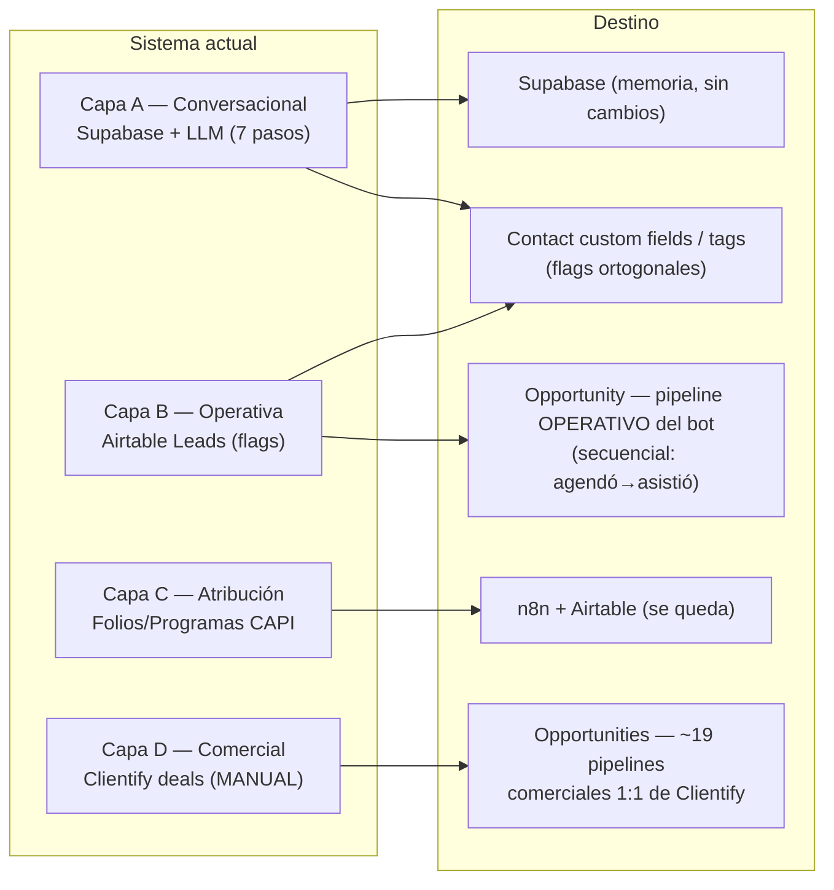

# 03 · Datos — Pipelines, deals y estado → GHL Opportunities

> **🔴 Riesgo #2.** Reconcilia dos cosas que hoy viven **separadas**: la **Capa D** (pipeline comercial de Clientify — ~19 pipelines, 2.338 deals, **100% manual**, el bot no la toca) y la **Capa B** (estado operativo del bot — flags en Airtable Leads). En GHL ambas aterrizan sobre Opportunities/pipelines + Contact fields. El error a evitar (verificado en `02` §4): **colapsar los flags ortogonales del bot en una sola etapa lineal** — rompería el gate del rescate.
>
> Números corroborados contra el snapshot Clientify (2.338 deals, 266 companies) y `leads.csv`, 2026-08-26.

---

## 1. Las 4 capas de estado y dónde aterriza cada una en GHL

Recordatorio de `01_logica_actual/03_ciclo_de_vida`: **no hay un pipeline lineal único**, hay 4 capas superpuestas unidas solo por el teléfono.

| Capa | Hoy | Destino GHL | Doc |
|---|---|---|---|
| **A** conversacional | Supabase `n8n_chat_histories` + razonamiento LLM | **Supabase sin cambios** (memoria) + Contact custom `estado_conversacion` | `06` |
| **B** operativa (bot) | Airtable Leads: `Agendan cita`, `Asistió`, `Estado conversación`, `Link enviado`, `Toques`, … | **Contact custom fields/tags** (ortogonales) + **1 pipeline operativo mínimo** para la secuencia agendó→asistió (§5) | este doc §5 |
| **C** atribución | Folios/Programas CAPI + Meta | **Se queda en n8n/Airtable** | `05` |
| **D** comercial | Clientify deals (100% manual, el bot nunca los tocó) | **~19 pipelines → Opportunities 1:1** (§2-4) | este doc §2-4 |

> **La distinción que ordena todo el doc:** la Capa D (comercial) y la Capa B (bot) hoy **no se cruzan** — el equipo humano crea/trabaja deals en Clientify a mano; el bot solo escribe flags en Airtable. En GHL **siguen siendo dos cosas**: los pipelines comerciales migrados (§2, del equipo humano) y el pipeline operativo del bot (§5). No se fusionan.

---

## 2. Los ~19 pipelines de Clientify → GHL Pipelines (1:1)

**Decisión cliente (`cuestionario` P10; confirmada en `01_logica_actual/03_ciclo` §Validación #4 y en `ronda-2`, cerrados «Proceso de venta»):** *"reconstrúyanlo tal como está hoy, lo más parecido posible. Mismas etapas, mismos nombres, mismo orden. No queremos rediseñarlo… migrarlo igual y después nosotros depuramos."* (cita de P10) → **se replican TODOS**, se marca activo vs legacy, **no se descarta ninguno** salvo orden explícito del cliente (por eso los muertos también migran; el método permite descartar lo muerto, pero acá el cliente pidió explícitamente conservarlo).

**Contexto duro (snapshot):** **1.875 / 2.338 deals (80%) están `Expired`**; solo **82 vivos** (50 Open + 32 Won). Igual migran (histórico comercial que el cliente depura después).

| Pipeline Clientify | Deals | Vivos (op/won) | Tipo | Mapea a programa (`01`) |
|---|---|---|---|---|
| **Campaña Internados Erika** | 1.024 | 4 (0/4) | Nurturing/seguimiento (Día 1-20) | Internados — legacy campaign |
| **VENTAS EMA METODOLOGÍA** | 319 | 28 (27/1) | **Embudo de pre-venta** (funnel humano) | transversal (ver §5) |
| Campaña Australia Abril 25 | 291 | 0 | Campaña | Gap Year — **legacy muerto** |
| Venta SPE - Internados | 172 | 3 (0/3) | Campaña | Internados |
| «sin pipeline» | 110 | 6 (0/6) | Deals sueltos | — → GHL "default" |
| Afiliación Venttur | 88 | 1 (0/1) | B2B afiliados | — (no-programa) |
| **Operativo Internados** | 74 | 2 (2/0) | **Delivery/fulfillment** | Internados |
| Reclutamiento de escuelas | 43 | 0 | B2B (recluta escuelas) | — **legacy muerto** |
| Academias Deportivas | 33 | 0 | Nicho | — **legacy muerto** |
| Seguimiento | 28 | 1 (1/0) | Genérico | — |
| **Operativo Año Académico** | 28 | 3 (3/0) | Delivery | Intercambio académico c/familias |
| Viaje a Japón UP 2026 | 22 | 17 (0/17) | Viaje específico | — (**activo**, casi todo Won) |
| **Operativo Summercamp** | 22 | 2 (2/0) | Delivery | Campamentos de verano |
| **Operativo Idiomas** | 22 | 0 | Delivery | Cursos de idiomas |
| **Operativo Gap Year** | 19 | 4 (4/0) | Delivery | Gap Year / Estudia y Trabaja |
| **Operativo Pathway** | 18 | 8 (8/0) | Delivery | Pathway Alemania |
| **Operativo Educación superior** | 12 | 3 (3/0) | Delivery | Educación superior ⭐ |
| La Garenne Leon | 6 | 0 | Escuela específica | — **legacy muerto** |
| La Garenne CDMX | 6 | 0 | Escuela específica | — **legacy muerto** |
| Por defecto | 1 | 0 | Default Clientify | — |

> ⭐ **Hallazgo relevante para `10`:** "Educación superior" es uno de los 3 programas **huérfanos en el bot** (sin enum, sin drip, sin rescate, sin pixel) — pero **SÍ existe comercialmente** con su `Operativo Educación superior` (12 deals) trabajado a mano. O sea: el huérfano es del lado *automatización*, no del lado *negocio*. "Viajes educativos" y "Cursos de idiomas" difieren: Idiomas tiene `Operativo Idiomas` (comercial), Viajes educativos **no tiene ni pipeline** → es el único 100% nuevo en ambos lados.

**Reconstrucción:** cada pipeline Clientify → **1 GHL Pipeline**; cada `pipeline_stage` → **1 GHL Stage** (en orden); cada deal → **1 Opportunity** en ese pipeline+stage (§3). Las etapas se copian **verbatim** del snapshot. Los 7 `Operativo *` (delivery por programa) tienen etapas operativas ricas — ejemplos reales:

- **Operativo Internados** (13 stages): Envío de aplicación a la familia y revisión → Envío a la institución → Exámenes posicionamiento → Aceptación y recepción de facturas → PRESENTACIÓN → PRESUPUESTO ABIERTO/PAGADO → Pago del programa → Recepción de documentos para visado → Gestión de visado → Coordinar llegada → JUNTA FAMILIA + ESCUELA → **Estudiante en destino**.
- **Operativo Pathway** (9 stages): Enviar documentación para pre-evaluación → Presentar ETA a estudiante y papás → Cobrar Inscripción 1 → Cobrar inscripción 2 + escuela → Recopilar/Traducir documentación → Crear MEE → Cobrar Programa → **Estudiante en destino**.
- **VENTAS EMA METODOLOGÍA** (12 stages, embudo de venta): AA PÚBLICO → PERFILAMIENTO INDIVIDUAL → **AGENDÓ REUNIÓN** (204) → RE-AGENDÓ / NO ASISTIÓ / **ASISTIÓ A LA REUNIÓN** → PRESENTACIÓN → PRESUPUESTO ABIERTO/ENVIADO → (+ etiquetas de programa mezcladas: IDIOMAS, SUMMER CAMP).
- **Campaña Internados Erika** (12 stages, nurturing): Dejó Sus Datos → Contestó la llamada → Continuó Conversación WA → Día 1/5/10/**15**/**20** Seguimiento → Agendar Cita (de Venta / Venta Cruzada) → **Cita de Ventas concretada**.

> El listado **verbatim y exhaustivo de las etapas de los 19 pipelines** (para el import) es material de la Etapa 4 (guía paso a paso); acá se fija la regla (copiar 1:1) y las etapas load-bearing del diseño. Fuente: `00_inputs/vtr-data-snapshot-2026-07-24.json` → `clientify.deals[].pipeline_stage_desc`.

> **Opción de acotamiento (no se ejerce por defecto):** 5 pipelines están 100% muertos (Campaña Australia, Reclutamiento, Academias Deportivas, La Garenne ×2 = 379 deals, 0 vivos). Por método serían candidatos a descarte (muertos), pero el cliente pidió migrar todo → **se migran igual**, marcados legacy. Si el cliente prefiere no arrastrarlos, se archivan post-migración (su decisión de depuración).

---

## 3. Deal → GHL Opportunity (campo por campo)

| Campo Clientify deal | Qué es | Destino GHL Opportunity | Qué cambia / nota |
|---|---|---|---|
| `id` | PK Clientify | **se descarta post-import** | queda el id de GHL |
| `name` | nombre del deal | **Opportunity.name** | 1:1 |
| `amount` / `amount_user` | monto | **Opportunity.monetaryValue** | número; ver bandera moneda |
| `currency` | MXN / USD (mezclados) | **acompaña el value** | ⚠️ GHL maneja moneda a nivel location → deals en 2 monedas: bandera §6 |
| `pipeline` / `pipeline_desc` | pipeline | **Opportunity.pipelineId** | al pipeline reconstruido (§2) |
| `pipeline_stage` / `pipeline_stage_desc` | etapa | **Opportunity.pipelineStageId** | a la etapa reconstruida (verbatim) |
| `status` / `status_desc` | Open/Won/Lost/**Expired** | **Opportunity.status** (open/won/lost/**abandoned**) | GHL no tiene "Expired" → mapear `Expired`→`abandoned` (bandera §6) |
| `contact` / `contact_email` / `contact_phone` / `contact_name` | contacto del deal | **Opportunity.contactId** | **link al Contact ya mergeado en `02`** (por teléfono canónico / email) |
| `company` | empresa | **Opportunity → Company vía el Contact** (§4) | GHL asocia la Opportunity a un Contact, no a una Company directa (bandera §6) |
| `owner_name` | asesor dueño | **Opportunity.assignedTo** | mapear owners Clientify → usuarios GHL (mismo mapeo que `02` §9.3) |
| `expected_closed_date` | cierre esperado | **Opportunity custom `cierre_esperado`** | GHL no tiene nativo fiable → custom |
| `actual_closed_date` | cierre real | **Opportunity custom `cierre_real`** | idem |
| `probability` / `probability_desc` | probabilidad | **Opportunity custom `probabilidad`** | GHL deriva de la etapa; se preserva el valor histórico |
| `deal_source` / `contact_source` / `contact_medium` | origen | **Opportunity.source** | 1:1 |
| `custom_fields` | CF del deal | **Opportunity custom fields** | catálogo en `04` |
| `tags` | tags del deal | **Opportunity/Contact tags** | catálogo y limpieza en `04` |
| `created` / `modified` | fechas | **dateAdded / dateUpdated** | ⚠️ validar seteo histórico en sandbox (mismo caveat que `02`) |

**Regla de vínculo (crítica):** cada Opportunity **cuelga de un Contact** (el del `02`). El deal de Clientify referencia al contacto por `contact` (id) / `contact_email` / `contact_phone` → se resuelve contra el Contact ya deduplicado. Los deals cuyo contacto caiga en las **poblaciones de contactos de `02`** (2.703 solo-Clientify, 2.410 phone-less — son conteos de **contactos**, no de deals) se enganchan por el mismo criterio de merge de `02` §2 (email → nombre+owner). **Orden de carga: Companies → Contacts → Opportunities** (`02` §8).

---

## 4. Companies (266) → GHL Companies

GHL tiene Companies nativas, pero su objeto es históricamente **más limitado que Contact** (soporte de custom fields y `assignedTo` no confirmado). Migración 1:1 **a validar en sandbox** (bandera §6.9).

| Campo Clientify company | Destino GHL | Nota |
|---|---|---|
| `name` | **Company.name** | 1:1 (ej. ITESO, Chapel Hill, Fulford Academy, Hebron Academy, College du Léman) — son **escuelas/instituciones**, no empresas del lead |
| `company_sector` | **Company.custom `sector`** | |
| `number_of_employees` / `_desc` | **Company custom** | |
| `taxpayer_identification_number` | **Company custom `rfc`** | |
| `facebook_url` / `linkedin_url` / `twitter_url` | **Company custom (social)** | |
| `owner` / `owner_name` | **Company.assignedTo** | mismo mapeo de owners |
| `custom_fields` | **Company custom fields** | → `04` |
| `created` / `modified` / `last_interaction` / `last_viewed` | fechas | validar seteo histórico |
| `picture_url` / `url` | **se descartan** | bajo valor / link a Clientify |

> Las companies son **instituciones educativas** (escuelas de destino), vinculadas a los deals de delivery (los `Operativo *`). El vínculo **Contact↔Company** se preserva nativo; el vínculo **Opportunity↔Company** se resuelve **vía el Contact** (GHL no expone relación directa Opportunity↔Company — bandera §6.9).

---

## 5. La Capa B (estado del bot) en GHL — el punto fino

Hoy el estado del bot son **flags ortogonales** en Airtable Leads. El verificador (`02` §4) marcó el error a evitar: **no colapsar los 4 flags en una etapa lineal**. Solución **híbrida**:

**(a) Secuencial → 1 pipeline operativo del bot (Opportunity).** La progresión `agendó → asistió` SÍ es lineal. Se reconstruye un pipeline operativo mínimo que el **bot** maneja (distinto de los comerciales del §2, que maneja el humano):

`Nuevo Lead → Contactado → En diagnóstico → Cita agendada → Cita confirmada → Asistió → (Ganado ↘ Perdido / Abandonado frío)`

> **🆕 2026-09-15 (reunión con cliente):** "Cualificado" sale del pipeline operativo del bot y queda **exclusivamente como TAG del contacto** (`SAf2PNSjPNNYJisUSAFq`). Ver §Cualificado abajo y `ESTADO_MIGRACION.md §Actualización 2026-09-16`.

Es donde el **reporte semanal lee "citas agendadas"** (`cuestionario` P11). ⚠️ **Es una reconstrucción, no un 1:1:** hoy el "funnel del bot" **no existe como pipeline** (son flags), pero su equivalente ya vive disperso en `VENTAS EMA` (AGENDÓ→ASISTIÓ) y `Campaña Internados Erika` (Día 1-20→Cita concretada). Darle un pipeline propio es la casa GHL-nativa de "¿dónde está este lead en el embudo del bot" y lo que el reporte necesita. **Bandera §6 — confirmar en `09`** que este pipeline operativo del bot no duplica el trabajo del equipo humano en los comerciales.

**(b) Ortogonal → Contact custom fields / tags (NO etapa).** Los flags que NO son una posición lineal:

| Flag Airtable | Destino | Por qué NO es etapa |
|---|---|---|
| `Agendan cita` (bool) | **etapa "Cita agendada"** del pipeline operativo (a) | es la transición secuencial |
| `Asistió` (bool) | **etapa "Asistió"** (a) | secuencial; se conserva en el modelo pero **NO alimenta el reporte semanal** — el cliente lo sacó (reporta solo citas agendadas; Max mide la asistencia aparte, `03_ciclo` §Validación #3) |
| `Estado conversación` (Contestó/Interrumpida/Cita conf.) | **Contact custom `estado_conversacion`** | ortogonal: un lead puede estar "interrumpida" con "link enviado=true" a la vez |
| `Link asesoría enviado` (bool) | **Contact custom `link_enviado`** | **es el GATE del rescate** — si fuera etapa, avanzar a "agendó" lo pisaría y el rescate nunca dispararía (`09`) |
| `Cualificado` (bool) | **Contact tag `cualificado`** (`SAf2PNSjPNNYJisUSAFq`) | 🔧 **CORREGIDO 2026-09-07:** NO lo escribe el agente en tiempo real. Hoy lo pone un **clasificador batch gpt-4o-mini (temp 0), ~8h post-conversación**, en `wf-resumen-etiquetas-seguimientos` (nodo OpenAI, IF `cualificado=="1"` → checkbox Airtable). **Criterio explícito (Tarea 5 del prompt): `1` si y SOLO si las 3**: (i) el usuario ya conoce un 2º/3º idioma; (ii) estudia/estudió en escuela privada **y** bilingüe; (iii) cumple la edad del programa (10-17 SummerCamp · 13-17 AñoAcadémico/Boarding · 18-30 Pathway/GapYear). Reconstrucción 1:1 = portar ese clasificador. **✅ CERRADO 2026-09-15 (reunión con cliente):** representación final = **TAG del contacto** (no etapa del pipeline). El clasificador batch ya está portado en el workflow `Xmyoewwa1W5gm1fy` (inactivo hasta post-cutover). |
| `Outreach enviado`, `Toques enviados`, `Ultimo toque at`, `Touch 1 programado at`, `Lead Score`, `Tipo lead`, `Última actividad` | **Contact custom fields** (`02` §4) | drivers de nurturing/tope, no posición de embudo |

> **Reconciliación de la doble representación de "cita":** `Cita confirmada` existe **a la vez** como valor de `estado_conversacion` y como etapa del pipeline operativo. Además `Agendan cita` (agendada — evento creado en Calendar) y `Cita confirmada` (confirmada — terminal) son **hitos distintos**: el pipeline los mantiene como etapas separadas (`Cita agendada → Cita confirmada → Asistió`). En GHL la **etapa del pipeline** es la fuente de verdad de la cita; el custom `estado_conversacion` la **refleja**, no la gobierna. Esto cierra la desincronización de origen (hoy `Agendan cita=true` puede convivir con `Estado='Interrumpida'`, `03_ciclo` §5.1).

**Guarda forward-only.** La lógica anti-downgrade del `wf-estado-lead` (no pisar un estado terminal con "Contestó") se replica en **n8n** (n8n-first): el workflow que escribe `estado_conversacion`/etapa chequea el estado terminal antes de degradar. No se delega a automatizaciones de GHL.

---

## 6. Banderas de este mapping

1. **Moneda mixta (MXN + USD) en los deals.** GHL fija la moneda a nivel *location*. Los deals vienen en las dos. Opciones a validar en sandbox: (a) `monetaryValue` numérico + custom `moneda` por Opportunity (preserva el dato, el rollup pierde precisión); (b) normalizar a una moneda con TC histórico (altera el monto). Recomendado (a) por fidelidad. → validar en `04`/ejecución.
2. **`Expired` → `abandoned`.** GHL tiene open/won/lost/abandoned; Clientify tiene Expired (80% de los deals). Mapear `Expired`→`abandoned` (no `lost`: no se perdió, caducó). Confirmar que el reporte no cuente abandoned como perdido, **y validar en sandbox que `abandoned` es seteable por API/import** (no solo por UI), porque cae ahí el 80% de los deals.
3. **El pipeline operativo del bot es una reconstrucción** (el funnel implícito de flags se hace explícito). Es la única pieza de `03` que no es 1:1 estricto. Justificada (GHL-nativo + el reporte lo exige) pero **se confirma en `09`** que no duplica los pipelines comerciales del equipo humano.
4. **Vínculo deal→Contact** depende del merge de `02`: deals de contactos solo-Clientify/phone-less se enganchan por email→nombre+owner. Los que no resuelvan quedan como Opportunities sin Contact (a revisar en la auditoría de migrabilidad).
5. **Migrar los 5 pipelines 100% muertos (379 deals)** es por instrucción explícita del cliente ("migrar todo"); el método los descartaría. Se migran marcados legacy; archivar es decisión de depuración del cliente, post-cutover.
6. **`«sin pipeline»` (110) + `Por defecto` (1):** aterrizan en un pipeline GHL "Sin asignar/Default" para no perder los deals.
7. **Owners de deals/companies → usuarios GHL:** mismo mapeo enumerado en `02` §9.3 (incluye gente que ya no está — decidir si se migran como usuarios inactivos o se reasignan).
8. **Migrabilidad Clientify** (caveat de cutover, no de diseño): no hay migración automática Clientify→GHL; los 2.338 deals + 266 companies son **reconstrucción manual o por CSV bulk** (la auditoría `ronda-2` §B2 la dimensiona). La topología de este mapping no cambia según su resultado.
9. **Companies en GHL — validar en sandbox** (load-bearing, hoy asumido 1:1): (a) que el objeto Company acepte **custom fields arbitrarios** (sector/rfc/social) y `assignedTo` — si no, esos campos van a nota/descarte; (b) que exista relación **Opportunity↔Company**: GHL asocia la Opportunity a un Contact, no a una Company directa → el vínculo escuela↔deal de los `Operativo *` se deriva **vía el Contact** (Contact↔Company), no directo. Ajustar la estrategia de import en consecuencia.

---

*Corroborado contra el snapshot Clientify (2.338 deals en 19+1 pipelines, 266 companies; 1.875 Expired / 381 Lost / 50 Open / 32 Won) y `leads.csv` en `00_inputs/`. 2026-08-26.*
