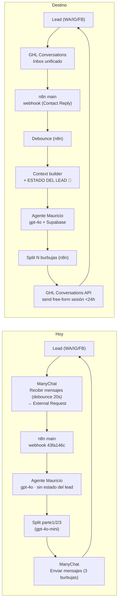

# 06 · Canal WhatsApp + Agente "Mauricio" → GHL Conversations + n8n

> **🔴 Riesgo #3.** Es el núcleo conversacional: reemplaza ManyChat por GHL Conversations sin perder capacidad, mantiene al agente "Mauricio" en n8n (decisión N.2), y corrige de paso el **gap #1 del sistema** (el agente hoy **no recibe estado del lead**) + la mayor densidad de bugs de origen. La WABA/portabilidad no cambia esta topología (solo número-migrado vs chip-nuevo).
>
> Corroborado contra `wf-venttur-main.json`, el snapshot ManyChat (16-17 flows, 13 CF, 5 tags), `analisis-manychat-vs-ghl-2026-08-26.md` y `portabilidad-numero-whatsapp-2026-08-18.md`.

---

## 1. El loop conversacional — hoy vs destino

**Cambios estructurales (todos 1:1 salvo los marcados 🔧 fix):**
- `Recibir mensajes` (ManyChat, External Request) → **Contact Reply trigger de GHL → HTTP Request al webhook de n8n**. Menos hops: `lead→MC→n8n` pasa a `lead→GHL→n8n`.
- **Debounce 20s** (hoy en ManyChat) → **n8n** (n8n-first). Wait node / colapso por sessionKey.
- 🔧 **Context builder inyecta el estado del lead** (hoy el User Message es solo `texto + fecha` — gap #1). En destino, antes del agente se lee el Contact de GHL (estado_conversacion, link_enviado, programa, toques, cita) y se inyecta al `[CONTEXTO TURNO]`. Es el fix del hallazgo central del Reporte la agencia 1.
- `Enviar mensajes` (parte1/2/3, ManyChat) → **n8n envía N mensajes vía GHL Conversations API** (mensaje de sesión free-form; ver §4).

---

## 2. ManyChat (8 casilleros activos) → GHL (mapeo 1:1)

Fuente: `analisis-manychat-vs-ghl-2026-08-26.md` §2.1. Venttur usa ~20% de ManyChat (un caño para templates), **casi todos** sus flows con `When [vacío]` (sin trigger propio, solo `sendFlow` desde n8n) — la excepción es `Asignar número` (`content20250918181220_518318`), disparado por *Tag applied*, que es una regla de evento, no un template invocado por API (14-15 de 16, `manychat-flows-inventario-2026-08-17.md`).

| ManyChat (hoy) | GHL (equivalente) | Qué cambia |
|---|---|---|
| Canal WhatsApp (WABA conectada) | **Conversations + WhatsApp Business Platform (LeadConnector)** | La WABA se conecta al BM de Venttur como cualquier BSP; mismo Inbox que IG/FB/SMS/Email |
| 16-17 flows (= templates por API) | **Message Templates + Workflow Send Action** | Cada flow → una template + un workflow que la envía; colapsan ~17→~10 (varios son la misma template por programa) |
| 13 custom fields | **Contact custom fields** | 1:1, mejor tipados (dropdown vs texto). Los transitorios (`parte1/2/3`, `respuesta_definitiva`) se descartan → `02` §6 |
| 5 tags | **Contact tags** | 1:1; se descarta el huérfano `wpp` → `04` |
| External Request (Default Reply) → n8n | **Contact Reply trigger → HTTP Request → n8n** | reemplazo directo (§3) |
| Live Chat / Inbox del equipo | **Conversations Inbox** (unificado WA/IG/FB/SMS/Email) | superior: hoy no hay un único lugar |
| Handoff manual (pausar bot + asignar) vía flow "Elevar" | **Assign to User + pausar automation + notificar** | §5; corrige el bug "Notify Assignees: 0" |
| Variables `{{first_name}}` | **Merge Fields `{{contact.first_name}}`** | sintaxis distinta, mismo poder |

**ManyChat desaparece por completo** — ni siquiera queda como capa de envío (ese rol lo absorbe el Workflow Send Action + la Conversations API de GHL). Capacidades nuevas que suma GHL (no obligan nada, quedan disponibles): comment→DM con IA nativa (IG/FB), Communities, Forms/Surveys, Sites, Calendars (`07`). Lo único que ni ManyChat ni GHL garantizan: auto-DM a nuevos followers IG (límite de la API de Meta, no de la plataforma).

---

## 3. Agente "Mauricio" — se queda en n8n (qué cambia)

**Decisión N.2 (n8n-first):** el agente **no** migra al Conversation AI de GHL. Se queda en n8n con gpt-4o + Supabase. Razón: ahí vive la lógica, ahí la agencia controla el debugging, y la memoria + memoria sintética ya están montadas.

| Aspecto | Hoy | Destino |
|---|---|---|
| Modelo | gpt-4o, temp 0 (`OpenAI \| Venttur`) | **igual** |
| System prompt | inline vivo **~39K chars, todavía con `contestan_2do`** — ≠ el archivo `agente-...-v2.0.md` (~47K, ya sin el fantasma) | **igual a la fuente que se elija para el cutover** — definir cuál manda (¿"= lo vivo" ~39K a limpiar, o "= v2.0" ~47K ya limpio?); en ambos se elimina `contestan_2do` |
| Memoria | Postgres Chat Memory (Supabase), `contextWindowLength 35` | **igual** — Supabase no migra a GHL |
| sessionKey | `whatsapp_phone.replace('+','')` — **NO normaliza 52→521** (riesgo de doble sesión) | 🔧 **fix: normalizar 52→521** (como outreach/rescate) — cierra la doble identidad |
| Input al agente | `Mensaje del usuario: {texto}` + `Fecha de hoy` — **sin estado del lead** | 🔧 **fix gap #1:** el context builder lee el Contact de GHL e inyecta `estado_conversacion`, `link_enviado`, `programa`, `toques`, `cita`, nombre → el agente sabe si ya mandó el link, si agendó, su programa |
| Tools | `crear_contacto` (toolWorkflow), `elevar` (toolHttpRequest) | `crear_contacto` → **upsert de Contact GHL** (`02` §7, una sola alta); `elevar` → **Assign+notify GHL** (§5) |
| Tool fantasma `contestan_2do` | instruida en el prompt, sin nodo | **se elimina del prompt** (`00` §6) |

El diagnóstico de 7 pasos, la metodología EMA, los frameworks (Voss/Hormozi), las 10 reglas de comportamiento y la matriz de links por programa (`07`) **se replican tal cual** — no se rediseña el prompt, solo se le da estado (gap #1) y se limpia el fantasma. El precio con rango por programa (decisión cliente) es un cambio de prompt que ya venía aparte, no de esta migración.

---

## 4. Camino de envío — dos rutas (la corrección clave del overview)

WhatsApp exige plantilla aprobada **solo fuera de la ventana de 24h**. Dentro de la ventana (respuesta a un inbound del lead), se envía **texto libre de sesión**. Un agente LLM genera respuestas dinámicas → **no pueden ser plantillas de estructura fija**. Por eso hay dos rutas:

| Ruta | Cuándo | Cómo en GHL | Origen hoy |
|---|---|---|---|
| **(a) Reply conversacional del agente** | dentro de 24h (responde a un inbound) | **n8n → GHL Conversations API, mensaje de sesión free-form** | `Enviar mensajes` (parte1/2/3) |
| **(b) Re-enganche proactivo** | fuera de 24h (nurturing, rescate, outreach, recordatorios) | **n8n decide el timing e invoca el envío del Message Template vía API de GHL** (coherente con n8n-first; el "Workflow Send Action" de GHL queda solo como alternativa si la API no expone el send de template) | los 16-17 flows |

**El split multi-burbuja (parte1/2/3) se conserva en n8n** (n8n-first): el agente produce `respuesta_definitiva`, un nodo la parte en N mensajes (el gpt-4o-mini splitter actual), y n8n **envía N mensajes de sesión** por la Conversations API con un pequeño delay entre burbujas (cadencia humana). No se colapsa a un solo mensaje; no se delega a GHL.

> **Corrige el overview:** la v0 del mermaid ruteaba TODO por templates. El reply del agente NO usa template — va free-form. Solo el re-enganche fuera de ventana usa templates. Ver `00` §2 (ya corregido).

---

## 5. Handoff a humano (flow "Elevar") → Assign + notify

Hoy: la tool `elevar` (toolHttpRequest) hace `sendFlow` al flow ManyChat "Elevar" (`content20250716130059_365663`), que **pausa el bot para siempre + asigna la conversación + Notify Assignees: 0 people** → 🐛 **el equipo humano puede no enterarse** (leads en limbo). Disparo: el lead pide humano/emergencia, o repite el MISMO mensaje 2+ veces consecutivas.

Destino (1:1 + 🔧 fix del bug):
- **Assign to User** (el asesor del programa, o Mauricio/Max) en GHL Conversations.
- **Pausar la automation** del bot para ese Contact (equivalente al "pause forever").
- 🔧 **Notificar a Mauricio y Max** por **email + notificación de app + inbox de GHL** (decisión cliente `cuestionario` P8) — corrige el "Notify Assignees: 0".
- El disparo (pedido de humano / repetición consecutiva) se mantiene en la lógica del agente; la excepción anti-elevación (misma frase NO consecutiva) también.

---

## 6. Audio, IG/FB y debounce (piezas del canal)

- 🔧 **Transcripción de audios.** Hoy la rama `Hay audios?` es una **condición imposible** (`and` + `audio[0] equals "webp"` sobre una URL de S3) → **nunca corrió**; una nota de voz llega al agente como string vacío. Destino: inbound WA audio → GHL guarda el media → n8n lo baja → whisper-1 → texto al agente. Se **construye y testea como camino nuevo** (casos de audio en la guía de testing), no se asume que "funciona tras migrar" (`00` §6, asimetría argumentada).
- **IG/FB.** Hoy ManyChat cubre IG/FB además de WA. GHL Conversations **unifica los 3** en un Inbox → el mismo Contact Reply trigger rutea IG/FB al mismo webhook n8n. Sin canal nuevo que construir; es capacidad nativa.
- **Debounce 20s.** Hoy en el flow ManyChat "Recibir mensajes". Destino: **n8n** (Wait / colapso "gana el último" por sessionKey), coherente con el patrón ya usado en otros clientes.

---

## 7. Consolidación a un número + WABA

**Decisión cliente:** **un solo número** para conversación + confirmación + recordatorios (`cuestionario` P3/P9). Hoy son **dos**: ManyChat (agente) + **Clientify (recordatorios de cita, fuera de los 14 workflows)**. En GHL, confirmación y recordatorios salen del mismo número del agente → los recordatorios de Clientify se **reconstruyen desde cero** en GHL (`07`), no migran (no están en ningún workflow n8n).

⚠️ **Reconciliación de números (bandera):**
- El `+52 1 33 1944 2476` que aparece 21 veces **NO es el canal**: es el **directo de Rodrigo** que el flow "Agenda" comparte al agendar. **Se preserva** como dato de negocio (KEEP), no se reconcilia como canal.
- `ronda-2` tiene una inconsistencia interna: su tabla de cerrados llama a `1944 2476` "número único vigente", pero B1 da `+52 1 33 2627 4502` (WABA `1931874540684022`) como el número del **bot**. **Desambiguar cuál de los dos es el canal de ManyChat antes del cutover.**

**WABA / portabilidad (caveat, NO cambia la topología):**
- GHL tiene camino nativo **"Migrate from an existing BSP"** (no recrea la WABA). Preserva número, display name, calidad, límites de mensajería, OBA y **plantillas aprobadas** — **solo si la WABA vive bajo el BM de Venttur** (escenario A).
- Si el número lo proveyó ManyChat (escenario B, "Collazo") → **no portable → chip nuevo** → todas las plantillas se re-crean/re-aprueban (24-72h) y el número arranca en 250 conv/24h.
- **Toda plantilla ausente de la WABA migrada** — incluidas las 3 faltantes `seg_dia_3/5/7_bs` (34 fallos de entrega en el Reporte la agencia 1) — se re-crea y re-aprueba: **agendar antes del cutover 15/9**. Deadline propio de portabilidad: **1/9**.
- Detalle completo: `06_docs/portabilidad-numero-whatsapp-2026-08-18.md`.

---

## 8. Banderas de este mapping

1. **Conteo de flows ManyChat: 16 (snapshot 07-24) vs 17 (inventario 08-17).** Reconciliar contra `manychat-flows-inventario-2026-08-17.md` al construir el catálogo de templates. Estimación de colapso: ~10.
2. **Reconciliación de los 2 números** (canal ManyChat vs el que `ronda-2` llama "vigente") — desambiguar antes del cutover (§7).
3. **WABA portable sí/no** — determina número-migrado vs chip-nuevo; deadline 1/9. No bloquea el diseño.
4. **El agente queda en n8n** (N.2). Si en el futuro se evalúa el Conversation AI de GHL, cambia este doc entero — declarado, revisable.
5. **Camino free-form de sesión** (§4): validar en sandbox que LeadConnector permite el send de mensaje de sesión (no-template) por API dentro de la ventana de 24h. Es load-bearing para el reply del agente.
6. **sessionKey MX** (§3): el fix de normalización 52→521 debe aplicarse junto con la canonicalización de la migración (`02`) para no partir sesiones entre el histórico y lo nuevo.

---

## 9. Contratos de diseño heredados del incidente Nahe (16/9/2026)

El 15/9 se detectó en producción un modo de falla del agente que **no estaba cubierto por los diseños previos** de esta migración: el modelo aceptaba **coordinar citas por chat** cuando no tiene tool de calendar, produciendo citas fantasma que nadie del lado de Venttur cubría. Reconstrucción, causa raíz y fix aplicados: `06_docs/incidente-nahe-2026-09-15.md` + `06_docs/barrido-leads-promesa-fantasma-2026-09-16.csv` (34 leads afectados en 30 días).

La causa **no era fire-and-forget** (el envío técnico funcionaba). Era **el prompt** el que le enseñaba al agente a "coordinar el horario a mano" cuando ya había mandado el link. La regla generalizable — **"el agente nunca promete acciones que no puede ejecutar"** — es un contrato de diseño que la migración a GHL debe heredar tal cual, en las dos capas.

### 9.1 · Capa prompt · REGLA ABSOLUTA "No agendo yo"

Se agregó al system prompt vivo (v2.0 → v2.1, `04_agents/agente-venttur-system-prompt-v2.1.md`) como Regla rectora #8:

- Prohíbe explícitamente coordinar / agendar / programar / confirmar / reservar cita por chat.
- Lista frases prohibidas (*"voy a coordinar", "quedamos", "programamos la llamada", "te confirmo el horario", "coordinamos"*).
- Instrucción de re-envío del link cuando el lead vuelve pidiendo agendar (revierte la regla previa de "no re-envío si ya se mandó", que combinada con "coordinar a mano" producía el bug).
- Explica el motivo (no hay tool de calendar) y remite al caso Nahe.

**En la migración a GHL:** el prompt es la fuente de verdad del comportamiento, y ese contrato **manda por sobre cualquier decisión que hayamos tomado al mapear ManyChat→GHL**. Aplicable tanto si el prompt del cutover es el ~39K vivo pre-Nahe (limpiado) como si es la v2.1 ya con la regla — pero **la regla tiene que estar**. Ver `08 §5` para el chequeo pre-cutover del prompt.

### 9.2 · Capa estructural · guardrail determinístico

Un LLM puede fallar bajo presión conversacional aunque el prompt lo prohíba (validado en producción: Nahe insistió 6 veces a lo largo de 5 días). Por eso se agregó un **nodo Code entre el splitter de burbujas y el sender** (`Detectar promesa fantasma` en n8n) que:

- Detecta con regex determinística el patrón "verbo de coordinar/quedar + referencia temporal, sin URL canónica en el mismo turno".
- Si dispara, **reemplaza el mensaje del agente** por el link canónico del programa del lead + framing de disculpa.
- Emite flag `_phantom_promise_intercepted: true` para alerta P1 Telegram + persistencia en `vtr_phantom_interceptions` (Postgres).
- Tests golden: 12/12 casos validados antes del deploy, incluyendo mensajes verbatim de Nahe. Ubicación: `03_workflows/vivo-2026-09-16-post-fix-prompt-guardrail/detectar-promesa-fantasma.js` + `test-detector.js`.

**En la migración a GHL:** el guardrail **se preserva tal cual** en el camino de envío del agente (Fase 4 de `06 §4 ruta a`). Como el reply del agente sigue siendo n8n-first (el splitter multi-burbuja no se delega a GHL), **el mismo Code node vive en n8n** entre el splitter y la Conversations API. Cero cambios estructurales por la migración.

### 9.3 · Fila nueva en la tabla §3 (destino post-cutover)

| Aspecto | Hoy (post-16/9) | Destino |
|---|---|---|
| REGLA ABSOLUTA "No agendo yo" en system prompt | ✅ vigente (v2.1, Regla rectora #8) | **igual — heredar tal cual** |
| Guardrail `Detectar promesa fantasma` (Code node) | ✅ vigente entre Formatear→Normalizar burbujas | **igual — heredar tal cual, mismo Code, mismos tests** |
| Alerta P1 Telegram + INSERT `vtr_phantom_interceptions` | ✅ vigente | **igual — el Postgres de Supabase no migra a GHL** (`06 §3`) |
| Digest diario 08:00 CDMX guardrail | ✅ workflow separado activo (`BzBCMGxEdJy6zmA9`) | **igual — trigger cron en n8n** |

### 9.4 · Anti-patrón generalizable · para agentes futuros

El aprendizaje excede a VTR. La regla **"el agente nunca promete acciones que no puede ejecutar"** aplica a cualquier bot conversacional cuya superficie de acciones sea acotada (tools de calendar, pagos, envíos, etc.). Cuando el modelo puede *hablar* de una acción pero no puede *hacerla* por API, hay que:

- Explicitar la prohibición en el prompt (regla dura, no consejo).
- Sostener con guardrail estructural (regex/heuristica determinística, no otro LLM).
- Persistir cada intercepción para poder auditar el patrón después.

Este patrón queda documentado como referencia interna. Aplicable a HPF/SYS/TFO/otros clientes cuando corresponda (fuera de scope de esta migración).
7. **Secretos hardcodeados** (Bearer ManyChat, API key OpenAI de whisper, token Clientify): rotar y mover a credenciales antes del handoff.
8. **Capacidades del canal GHL a validar en sandbox** (load-bearing — sin ellas la topología no se sostiene; se suman a `00` §7.10): (a) **Contact Reply trigger** — que exista para WA/IG/FB, dispare un HTTP/webhook a n8n y pase el cuerpo del mensaje + el id de contacto (es el path de entrada de TODO el inbound, §1); (b) **send de Message Template Meta** con merge params dinámicos por programa vía API de GHL invocada desde n8n (§4); (c) **inbound de audio** — que GHL Conversations exponga una URL de media descargable para que n8n la baje a whisper (§6); (d) **silenciar la automation del bot por-contacto** de forma persistente y reversible (DND vs remove-from-workflow), para el handoff (§5). Además el send free-form de sesión <24h ya listado (bandera 5).

---

*Corroborado contra `wf-venttur-main.json`, snapshot ManyChat, `analisis-manychat-vs-ghl-2026-08-26.md` y `portabilidad-numero-whatsapp-2026-08-18.md`. 2026-08-26.*
