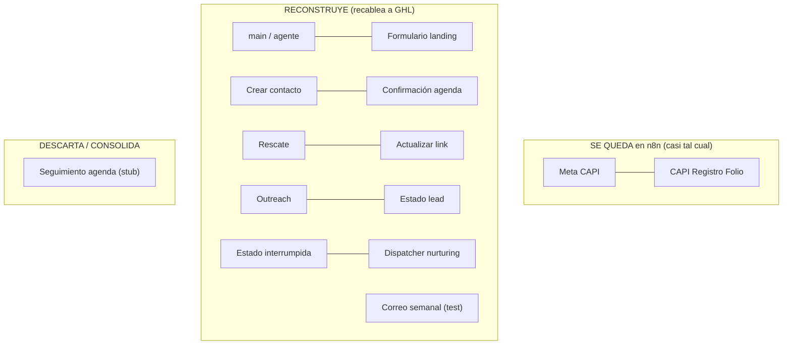

# 08 · Los 14 workflows n8n → se-queda / reconstruye / descarta

> **🟡 Riesgo medio.** Catálogo maestro: cada uno de los 14 workflows de producción se clasifica en **SE QUEDA** (sigue en n8n casi tal cual), **RECONSTRUYE** (misma función, recableado a GHL en vez de ManyChat/Clientify/Airtable) o **DESCARTA/CONSOLIDA** (muerto o duplicado). El detalle fino de cada reconstrucción vive en el doc que se indica.
>
> Corroborado contra los 14 JSON de `00_inputs/` (Agent-B, `01_logica_actual/02_triggers_y_eventos`).

---

## 1. Principio de reparto (n8n-first)

n8n **sigue siendo el cerebro**. Lo que cambia no es *dónde vive la lógica* (n8n) sino *contra qué sistema habla*: hoy escribe a **ManyChat + Clientify + Airtable**; en destino escribe a **GHL** (Contacts/Opportunities/Conversations/Calendars) + **Supabase** (memoria, sin cambios) + **Meta CAPI** (sin cambios). Ningún workflow migra a "automatizaciones nativas de GHL" salvo el reporting, que es la única pieza donde GHL nativo tiene ventaja clara.

---

## 2. Catálogo maestro

| # | Workflow (id) | Trigger hoy | Toca hoy | **Destino** | Qué cambia | Detalle |
|---|---|---|---|---|---|---|
| 1 | **`wf-venttur-main`** (`k3aivKSP67S97IHn`) | Webhook (ManyChat External Request) | ManyChat, OpenAI, Airtable, Supabase, Clientify(sub), CAPI(sub), S3 | **RECONSTRUYE** | entrada por **Contact Reply de GHL**; debounce a n8n; 🔧 **inyecta estado del lead** (gap #1); 🔧 fix `Repetido?`, `Hay audios?`, sessionKey MX; salida free-form por Conversations | `06` |
| 2 | **`wf-meta-capi`** (`z98w2yWVEMOfifMl`) | Execute WF desde main (paralelo) | Airtable (Folios/Programas), Meta Graph v21 | **SE QUEDA** | lógica CAPI tal cual; 🔧 CTWA deja de hardcodear `{Programa}='BS'` (data-driven); 🔧 el lookup del lead se **repunta de Airtable Leads a la GHL API por teléfono** (N.4, validar en sandbox) | `05` |
| 3 | **`wf-capi-registro-folio`** (`9yCbynoKDt9hgiBq`) | Webhook desde `go.venttur.com` (en el clic) | Airtable (Folios CAPI) | **SE QUEDA** | tal cual; la landing sigue disparándolo | `05` |
| 4 | **`wf-formulario-clientify`** (`ZB6erhWicZmDfC4I`) | Webhook desde landing (submit) | Airtable (Leads), Clientify | **RECONSTRUYE** | crea **Contact GHL** (no Clientify+Airtable); 🔧 fix isExecuted; 🔧 persiste `Programa interés`; la landing `go.venttur.com/bs` **se repunta a GHL** | `05`/`10` |
| 5 | **`wf-crear-contacto-clientify-airtable`** (`cZUNKQyZNOHy5twQ`) | toolWorkflow `crear_contacto` (agente) | Airtable (Leads), Clientify | **RECONSTRUYE + COLAPSA** | **una sola alta** en GHL (elimina la doble alta determinística+agéntica); el agente solo enriquece el Contact | `02` §7 |
| 6 | **`wf-confirmacion-agenda`** (`2PSekVBxarsrnVBu`) | 3× Google Calendar Trigger (`eventCreated`) | GCal, Clientify, Airtable, ManyChat, Telegram | **RECONSTRUYE** | disparo por **GHL Calendar**; confirmación con fecha/hora/asesor/link; 🔧 fix el bug 0/11 (enviaba antes de morir); **path de Diego se borra** | `07` |
| 7 | **`wf-seguimiento-agenda`** (`DZlSEQS5qzX1Y01K`) | Execute WF (nodo padre DISABLED) | Airtable, ManyChat | **DESCARTA / CONSOLIDA** | stub con placeholder, hoy no corre; su objetivo (link sin cita a 48h) se **consolida** en el rescate | `00` §6, `09` |
| 8 | **`wf-rescate-post-link`** (`mkEP1qFN7MVb9qP0`) | Execute WF desde `Actualizar link` | Airtable, ManyChat, Supabase, Telegram | **RECONSTRUYE** | rescate en n8n; envío por **template GHL**; 🔧 fusiona "Estudio y Trabajo" (código muerto); memoria sintética sigue en Supabase | `09` |
| 9 | **`wf-actualizar-link-enviado`** (`gRSMjzxggA4UePjz`) | Execute WF desde main (output con `promo.venttur.com/`) | Airtable, Clientify, n8n | **RECONSTRUYE** | marca **Contact custom `link_enviado`** (el gate); 🔧 fix bug tag `.variable`; dispara la cadencia consolidada | `09` |
| 10 | **`wf-outreach-form-meta`** (`CUuFxbst3iHpgeXS`) | Google Sheets Trigger + Cron | Google Sheets, Airtable, ManyChat, Supabase | **RECONSTRUYE** | tri-toque en n8n; envío por **template GHL**; sujeto al **tope global de 2**; `Programa interés` deja de hardcodear "Boarding School" cuando haya otras campañas | `09` |
| 11 | **`wf-estado-lead`** (`b52CUYEkI2Ah3Xj6`) | Execute WF desde main (cada inbound) | Airtable (Leads) | **RECONSTRUYE** | escribe **Contact custom `estado_conversacion`** + `ultima_actividad`; guarda forward-only en n8n | `03` §5, `06` |
| 12 | **`wf-estado-interrumpida`** (`H6qYB3Oj97bxaTCX`) | Schedule (cada 1h) | Airtable (Leads) | **RECONSTRUYE** | barrido sobre Contacts GHL; 🔧 resolver **24h (vivo) vs ~5 días (cliente)** | `09` |
| 13 | **`wf-resumen-etiquetas-seguimientos`** (`DyrDumQgb6S4zHsS`) | Execute WF desde main (+8h) | Supabase, OpenAI, Airtable, Clientify, ManyChat | **RECONSTRUYE** | dispatcher LLM de nurturing; 🔧 fix el gate `asesoria=='cero'` roto (usa el campo real `link_enviado`); el **orden del Switch se descarta** (multi-programa por contexto) | `09` |
| 14 | **`wf-correo-semanal`** (`BrFfQyDfamdUzq64`) | Schedule (lunes) | Airtable (Reporte semanal), OpenAI, Gmail | **RECONSTRUYE** | reporte **solo con citas agendadas** (decisión cliente); destinatario real (no el de prueba); reporting nativo GHL o n8n | §3 |

---

## 3. El reporte semanal (workflow 14) — nota aparte

Hoy `wf-correo-semanal` está en **modo test** (`active:false`, destinatario `[EMAIL-AGENCIA]`, cuerpo "CORRER FLUJO MANUAL", solo procesa la 1ª fila) y **consume** métricas ya agregadas de la tabla Airtable "Reporte semanal" (no las calcula — la lógica de agregación vive en rollups/fórmulas de Airtable, ubicación incierta).

Destino:
- **Métrica única: citas agendadas** (decisión cliente `cuestionario` P11; la asistencia la mide Max aparte, no va al reporte).
- Definiciones del cliente: **Lead calificado** = avanza en el descubrimiento y encaja con el perfil (no basta una respuesta); **Conversación no continuada** = deja de contestar el seguimiento, ~5 días (ver `09`, choca con el barrido de 24h).
- **Dónde se calcula (por método, n8n-first):** por defecto **un workflow n8n lee las Opportunities de GHL y arma el email** (como hoy, pero leyendo de GHL en vez de Airtable — es el 1:1 fiel; el reporte ya vive en n8n). Alternativa: reporting **nativo** de GHL sobre el pipeline operativo (las "citas agendadas" salen de la etapa, `03` §5) — a **validar en sandbox** si cubre la métrica exacta. **El default es n8n; la decisión final va en la guía de ejecución.**

---

## 4. Lo que NO es un workflow pero migra/se queda

| Pieza | Destino |
|---|---|
| Agente "Mauricio" (nodo del main) | **n8n** (gpt-4o + Supabase), `06` §3 |
| Memoria `n8n_chat_histories` (Supabase) | **Supabase sin cambios** |
| Memoria sintética (la siembran outreach/rescate/dispatcher) | **Supabase sin cambios**; los workflows que la siembran se reconstruyen (`09`) |
| Tabla "Tabla apoyo (ignorar)" (ledger dedup) | **se descarta** (`00` §6); dedup vive en GHL/n8n |
| `errorWorkflow OBkUyb8fuo30DzA9` (webapp_errors → Supabase central la agencia) | **se queda** (infra de errores de la agencia) |

---

## 5. Banderas de este mapping

1. **Reporte semanal: n8n (default) vs GHL nativo** (§3) — por método el default es **n8n leyendo Opportunities de GHL**; el reporting nativo de GHL para la métrica exacta ("citas agendadas por semana desde la etapa") queda a validar en sandbox si se prefiere.
2. **CTWA hardcode `{Programa}='BS'`** (workflow 2): "correcto hoy (única campaña), insostenible mañana". La atribución pasa a data-driven por pixel/programa aunque solo Internados tenga campaña ahora → `05`.
3. **La landing `go.venttur.com/bs`** (workflow 4): sigue viva para orgánicos; hay que **repuntarla a GHL** para que no quede como puerta muerta. El formulario nativo de Meta ya la sustituyó para pago → `10`.
4. **Estado de deploy de `wf-estado-lead`** (workflow 11): `01`/`02` lo daban "pendiente"; `03_ciclo` §5.1 lo verifica **vivo** (18 ejecuciones). Se reconstruye asumiéndolo activo.
5. **Secretos hardcodeados** en varios workflows: rotar antes del handoff.

---

*Corroborado contra los 14 JSON de `00_inputs/`. 2026-08-26.*
