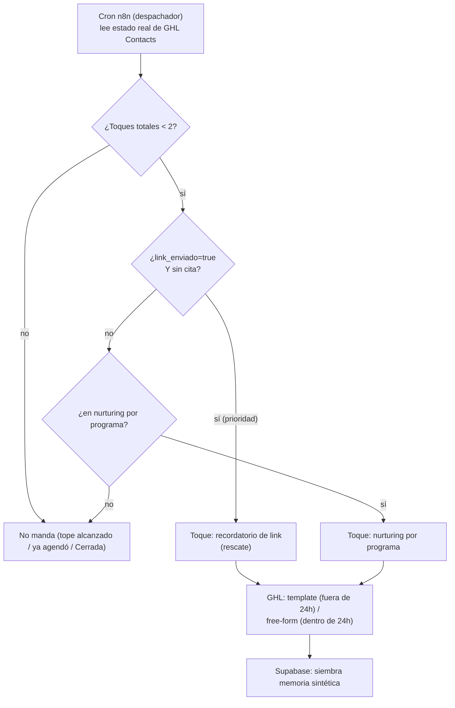

# 09 · Nurturing, rescate y re-enganche → n8n (despachador único) + templates GHL

> **🟡 Riesgo medio-alto.** Hoy hay **4 mecanismos de re-enganche paralelos** que se pisan y suman ~9 toques por contacto (causa de los 34 fallos de entrega del Reporte la agencia 1). El cliente decidió **consolidarlos en un despachador único en n8n con tope global de 2 toques**. Este doc reconstruye esa consolidación, corrige el gate roto del nurturing, y fija la política de reapertura ("Cerrada").
>
> Números del embudo corroborados contra `leads.csv` (3.819). Cadencias contra `01_logica_actual/05_reglas_negocio`.

---

## 1. Los 4 mecanismos de re-enganche hoy (y cómo se pisan)

| Mecanismo | Workflow | Disparo | Cadencia | Universo real (leads.csv) |
|---|---|---|---|---|
| **Outreach Form Meta** (tri-toque) | `wf-outreach-form-meta` | lead de Meta Lead Ads (Sheet) | **0h / +24h / +72h** desde creación | 460 con outreach enviado; 382 llegaron al toque 3 |
| **Rescate Post-Link** (2 fases) | `wf-rescate-post-link` | el agente manda `promo.venttur.com/…` | **+45 min / +24h** | **715 leads con link sin cita** (1.090 link enviado − 375 que agendaron) |
| **Nurturing drip** (4 toques por programa) | `wf-resumen-etiquetas-seguimientos` | +8h post-conversación | **0 / 1 / 3 / 5 días** | gate roto (ver §3) → hoy dispara de más |
| **Seguimiento agenda** (single-touch) | `wf-seguimiento-agenda` | link sin cita a 48h | **+48h** | **muerto** (nodo padre disabled) |

**Embudo (contexto):** 3.819 leads → 1.090 link enviado → **418 agendaron cita (total)** → 126 asistieron. De esos 418, **375 venían de un link enviado** (43 agendaron directo, sin link); por eso el **universo de rescate = 1.090 − 375 = 715** (link enviado sin cita). El rescate y el outreach son los que mueven la aguja; el nurturing drip y el seguimiento-agenda **se solapan** con el rescate (mismo objetivo: link sin cita) y con el tope viejo de ~9 toques generaban spam.

---

## 2. La consolidación — un despachador único en n8n

**Decisión de diseño de la agencia (`ESTADO` "Decisiones tomadas" 2026-08-17 / Reporte la agencia 1):** la cadencia **se muda de ManyChat a n8n** (`vtr-despachador-proactivo-v1.json`) — esto es arquitectura. El **tope global de 2 toques** (contando TODAS las secuencias) y la **prioridad `recordatorio de link` > `nurturing`** están tomados técnicamente pero **PENDIENTES de OK explícito del cliente** (delegó en el Reporte la agencia, no firmó — `ESTADO` gates, §8 bandera 1).

**Reglas del despachador (reconstrucción n8n-first):**
- **Un solo cron** lee el estado real de los Contacts de GHL (link_enviado, cita, toques_enviados, estado_conversacion, programa) — reemplaza los 4 disparos dispersos.
- **Tope global 2:** `toques_enviados < 2` contando outreach + rescate + nurturing juntos (hoy el techo real era ~9).
- **Prioridad:** si el lead tiene `link_enviado=true` y no agendó → **recordatorio de link (rescate)** primero; solo si no aplica → nurturing por programa.
- **Manda 1 solo mensaje por ejecución** (no burst).
- **Siembra memoria sintética** en Supabase (sin cambios respecto a hoy) para que el agente no re-salude cuando el lead responde.

> La cadencia temporal fina (¿a qué horas caen los 2 toques?) se define con el cliente; el diseño fija la **arquitectura** (un despachador, tope 2, prioridad), no los minutos exactos. Las cadencias viejas (0/24/72h, 45min/24h, 0/1/3/5d) quedan como referencia — el tope de 2 las recorta.

> **Separación con los pipelines comerciales (`03` §6.3):** el despachador y el **pipeline operativo del bot** (`03` §5) mueven **solo el estado del bot** (Contact custom fields + el pipeline operativo Nuevo→…→Asistió). **No tocan los ~19 pipelines comerciales** de Clientify (`03` §2), que trabaja el equipo humano a mano. Un mismo Contact puede tener a la vez una Opportunity operativa (del bot) y Opportunities comerciales (del humano) sin pisarse — son pipelines distintos.

---

## 3. El gate del rescate/nurturing — el fix central

Hoy el nurturing dispara si `asesoria == 'cero'` (el lead **no** recibió link). **El gate está roto por construcción:** la whitelist de "links para agendar" del prompt del dispatcher **no incluye** `promo.venttur.com/agendar-ema` (el link de Boarding/fallback) → todo lead que recibió ese link queda clasificado como "nunca recibió link" → entra al drip genérico. Es el 64% del Hallazgo 2 del Reporte la agencia 1 (las plantillas `seg_dia_*_bs` que fallan).

**Fix (reconstrucción):** el gate deja de depender de una whitelist de strings en un prompt LLM. Usa el **campo real `link_enviado`** (Contact custom, escrito determinísticamente por `wf-actualizar-link-enviado` cuando el output contiene `promo.venttur.com/`). Es exactamente el flag que `02` §4 y `03` §5 rutean como custom field (NO etapa) **para que avanzar a "agendó" no lo pise**. Determinístico, sin LLM, sin whitelist que mantener.

- `link_enviado=true` + sin cita → **rescate** (recordatorio de link).
- `link_enviado=false` → **nurturing por programa**.
- Ambos sujetos al tope global de 2.

---

## 4. Multi-programa por contexto (se descarta el orden del Switch)

Hoy el dispatcher tiene un Switch con orden `Pathway > Summer > AA Familiar > Boarding > Gap Year` que dispara **el primer match** — orden que "no parece deliberado" y que además sobrescribe `Programa interés` en cada corrida sin guarda (reclasifica conversaciones cerradas).

**Decisión cliente (`ronda-2` §6):** *"el bot pregunta / sugiere en base al contexto del lead. No hay orden fijo de prioridad."* → **el orden del Switch se descarta** (`00` §6). El programa que gobierna el nurturing sale del **descubrimiento conversacional** (lo que el lead dijo), no de una prioridad hardcodeada. Y 🔧 el nurturing **no sobrescribe** `programa_interes` de un lead ya clasificado (se agrega guarda).

---

## 5. Política "Cerrada" (reapertura de conversaciones)

**Decisión cliente (`ronda-2` §2):** cuando un lead cerrado/perdido vuelve a escribir, **el bot atiende normal**, con dos diferencias duras respecto del comportamiento que causó el incidente de agosto:
- **NO se sobrescribe el programa** capturado.
- **NO se dispara ninguna secuencia de nurturing** por la reapertura.

En GHL: el Contact conserva su `programa_interes` y su estado; el inbound entra por el mismo Contact Reply → agente (`06`), pero el despachador (§2) **excluye** a los Contacts en estado terminal/cerrado de arrancar una nueva cadencia. El bot responde el mensaje; no re-clasifica ni re-encola.

---

## 6. "Conversación interrumpida" — 24h vs ~5 días

**Conflicto de definición** (`00` §7.3): el barrido vivo (`wf-estado-interrumpida`) marca a **>24h** de silencio; el cliente define "conversación no continuada" para el **reporte** como *"deja de contestar el seguimiento… ~5 días"* (`cuestionario` P11).

**Resolución de diseño:** son **dos cosas distintas** que hoy se confunden:
- **Operativo (barrido):** marca `estado_conversacion='interrumpida'` a las >24h para *dejar de esperar respuesta en caliente* — sirve al despachador. Se mantiene (ajustable).
- **Reporte:** "conversación no continuada" = agotó la secuencia de seguimiento sin responder, **~5 días**. Con el **tope de 2 toques** el agotamiento llega antes que con el techo viejo → el "~5 días" se ancla al **fin de la secuencia consolidada**, no a un timer fijo. Se define la métrica del reporte sobre "secuencia agotada sin respuesta", no sobre las 24h del barrido.

Los dos umbrales conviven sin pisarse: uno es señal operativa, el otro es criterio de reporting. **Confirmar los números con el cliente** (el barrido a 24h es ajustable; el "~5 días" del reporte es su definición).

---

## 7. Los templates de re-enganche → GHL

Todos los toques de re-enganche son **fuera de la ventana de 24h** (el lead no escribió primero, o pasó tiempo) → **Message Templates de Meta** (no free-form). Origen: los flows de ManyChat de nurturing/rescate/outreach.

| Familia de mensajes | Hoy (ManyChat flow) | Destino |
|---|---|---|
| Outreach Touch 1/2/3 | `content20260612151152_969589` / `…193459` / `…185709` (template `boarding_form_followup`, MARKETING) | **Message Templates GHL**; n8n dispara el envío por API (`06` §4) |
| Rescate Fase 1/2 (6 programas × 2) | flow "Enviar mensajes" `content20250617172539_850988` (`parte1`) | **Templates GHL** por programa; 🔧 "Estudio y Trabajo" se fusiona con Gap Year (código muerto, `00` §6) |
| Nurturing drip (5 flows por programa, 4 toques c/u) | Boarding/Pathway/Gap/AñoAcadémico/SummerCamp + Lead General | **Templates GHL**; los ~17 flows colapsan a ~10 |
| Seguimiento agenda (48h) | `content20250718124614_140983` | **se consolida en el rescate** (no se recrea) |

**3 plantillas faltantes** (`seg_dia_3/5/7_bs`, 34 fallos de entrega): no están en el repo, viven en Meta/ManyChat → **exportar de Meta antes del cutover**; si la WABA no migra por BSP, se re-crean y re-aprueban (24-72h) → `06` §7.

---

## 8. Recontact policy del primer contacto post-cutover (🆕 reunión 15/9)

**Decisión del cliente:** al ejecutar el cutover 18-19/9, el despachador **NO puede spamear a los 5.000+ leads del embudo total**. Filtro dur: primer contacto post-cutover **solo a leads con `Link asesoría enviado = true` + `Agendan cita = false`**. Es el universo del "rescate post-link" — los que ya recibieron el link y no reservaron horario. Aproximadamente 715 leads (según `leads.csv` del 08/2026: 1.090 link enviado − 375 con cita = 715 sin cita).

**Implementación:** filtrar en el `Get Leads Pendientes` del despachador con `link_enviado=true AND cita=false AND estado_conversacion NOT IN ('Cerrada', 'Perdida')` durante los primeros 7 días post-cutover. Después de ese período, el despachador vuelve a su lógica normal (nurturing por programa + rescate + reactivación).

**Por qué**: (a) evitar avalancha de mensajes a Meta que dispare rate limits o downgrade de calidad de la WABA recién portada; (b) el resto del embudo (leads sin link enviado o con cita agendada) o bien ya está terminal, o bien no espera contacto proactivo. Priorizar los 715 que están "colgados con el link".

**Owner:** [J] al configurar el despachador post-cutover. Ver §2 (despachador único).

**Referencia:** decisión de la reunión 2026-09-15 con Mauricio + Max, documentada en `ESTADO_MIGRACION.md §Actualización 2026-09-16`.

---

## 9. Banderas de este mapping

1. **Tope global de 2 toques:** decisión técnica tomada, **sin OK explícito del cliente** (delegó en el Reporte la agencia, no aprobó). Diseñar con 2, marcar confirmable. Si el cliente quiere conservar más toques, la consolidación seguimiento-agenda+rescate (`00` §6) cambia.
2. **Cadencia temporal fina:** el diseño fija arquitectura (1 despachador, tope 2, prioridad); los minutos/horas exactos de los 2 toques se cierran con el cliente.
3. **"Interrumpida" 24h (operativo) vs ~5 días (reporte):** confirmar ambos umbrales (§6).
4. **`Lead Score` / `Tipo lead`** (drivers de priorización potenciales): su cálculo vive fuera de los workflows y no está localizado → si el despachador los usa, relocalizar el cálculo a n8n; si no, se migran congelados (`02` §9.7).
5. **Memoria sintética:** se mantiene en Supabase; los workflows que la siembran se reconstruyen apuntando a los mismos `session_id` (teléfono canónico, con el fix MX de `06`) para no partir sesiones.
6. **La landing `go.venttur.com/bs`** repuntada a GHL (`10`) alimenta el mismo despachador cuando un orgánico entra por ahí.
7. **Query de Contacts GHL por custom field** (load-bearing): el cron del despachador y el barrido de "interrumpida" filtran Contacts por `link_enviado`/`toques`/`estado_conversacion`/`cita` → **validar en sandbox** que la GHL API permite query/filter eficiente por valor de custom field (`00` §7.10i). Sin eso, ni el despachador ni el barrido se construyen como se describen.

---

*Corroborado contra `leads.csv` (1.090 link enviado → 375 agendaron con link / 715 sin cita; 418 agendaron en total) y `01_logica_actual/05_reglas_negocio`. 2026-08-26.*
