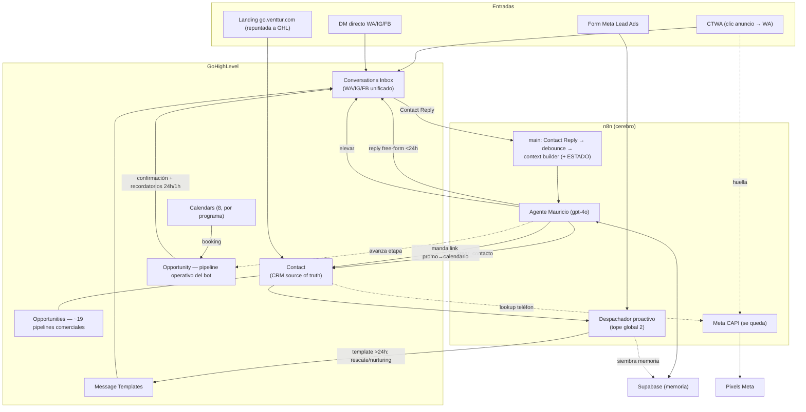

# 11 · Flujo end-to-end del lead post-migración

> **Síntesis.** El recorrido completo de un lead en el stack destino (n8n + GHL), atando los 10 docs anteriores. No introduce nada nuevo: es el mapa de cómo las piezas conversan.

---

## 1. Diagrama end-to-end

---

## 2. El recorrido, paso a paso

**1. Entrada.** El lead llega por uno de 4 caminos:
- **CTWA / DM** → entra a **GHL Conversations** (Inbox unificado WA/IG/FB). En paralelo, el clic dispara la huella CAPI que **se queda en n8n** (`05`).
- **Form Meta Lead Ads** → cae en el Sheet; el **despachador n8n** lo levanta y arranca el outreach (`09`).
- **Landing** `go.venttur.com` (repuntada a GHL, `08`/`10`) → crea el Contact.

**2. Identidad.** Todo lead resuelve a **un Contact de GHL** — la unión deduplicada de Airtable + Clientify + ManyChat por teléfono canónico (con el fix del quirk MX), corroborada por las FKs (`02`). Nunca se crean duplicados ni el triple-write viejo.

**3. Conversación.** El inbound entra por **Contact Reply → n8n** (debounce). 🔧 El **context builder inyecta el estado del lead** (programa, link_enviado, cita, toques) — el fix del gap #1: el agente ya no responde a ciegas (`06`). El **agente "Mauricio" (gpt-4o, en n8n)** hace su diagnóstico de 7 pasos, con memoria en **Supabase**. Responde **free-form de sesión** (dentro de 24h), partido en burbujas por n8n.

**4. Programa por contexto.** El agente **nunca asume el programa** del anuncio — lo descubre en la conversación (`01`, `06`). La atribución (medición) va por separado, automática, al pixel (`05`).

**5. Herramientas.** El agente:
- `crear_contacto` → **enriquece** el Contact (una sola alta, `02`).
- manda el **link del calendario** del programa (los 8, `07`) cuando hay claridad → marca `link_enviado` (Contact custom, el **gate**).
- `elevar` → **Assign to User + notifica a Mauricio/Max** (email+app+inbox) + pausa el bot (`06`).

**6. Re-enganche.** Si el lead recibió link y no agendó (universo de **715**), o si no recibió link, el **despachador único n8n** (tope global de 2, prioridad recordatorio-de-link > nurturing) manda **1 template** fuera de la ventana de 24h y **siembra memoria sintética** para que el agente no re-salude (`09`). Un lead cerrado que vuelve: **el bot atiende normal, sin re-clasificar ni re-encolar** (política Cerrada).

**7. Cita.** El lead reserva en un **GHL Calendar** (uno por programa, disponibilidad compartida por asesor). El booking → **Opportunity avanza** a "Cita agendada" en el pipeline operativo → dispara **confirmación** (fecha/hora/asesor/link) + **recordatorios 24h y 1h antes**, todo desde **el mismo número** (`07`). 🔧 Se corrige el bug que hoy deja 0/11 confirmaciones.

**8. Comercial.** El equipo humano trabaja los **~19 pipelines comerciales** migrados 1:1 de Clientify (`03`), colgados del mismo Contact. El bot **no los toca** — su embudo vive en el pipeline operativo.

**9. Reporte.** Métrica única: **citas agendadas** (leídas de la etapa del pipeline operativo). La asistencia la mide Max aparte (`08`).

---

## 3. Qué vive dónde (resumen de una línea)

- **GHL:** canal (Conversations), CRM (Contacts), pipelines (Opportunities comerciales + operativo), calendarios, templates.
- **n8n:** el agente, la orquestación (despachador, timing, condicionales), el CAPI.
- **Supabase:** la memoria del agente (real + sintética).
- **Meta/Airtable:** la atribución CAPI (huellas, pixels) — fuera del perímetro GHL.
- **ManyChat + Clientify:** **desaparecen.**

---

## 4. Lo que este diseño corrige de origen (todo verificado)

Gap #1 (agente sin estado) · confirmación de cita rota (0/11) · gate del rescate roto (64% de las fallas) · sessionKey MX (doble sesión) · `Agendan cita=true` antes del envío · `Hay audios?` imposible · handoff sin notificar (Notify:0) · fallback `agendar-ema` (programa/asesor equivocados) · doble grafía Boarding · dos números → uno · triple-write → un Contact.

> El **tope de ~9 toques → 2** es una **corrección propuesta, no aprobada** — depende del OK del cliente (ver §5).

---

## 5. Lo que queda como caveat operativo (no de diseño)

- **WABA portable sí/no** → número-migrado vs chip-nuevo (deadline 1/9). `06`, `portabilidad`.
- **Auditoría de migrabilidad de Clientify** → dimensiona automático vs manual (gate de cutover). `03`.
- **Asunciones de plataforma GHL** → validar en sandbox antes del import (dedup, fechas históricas, disponibilidad compartida, Contact Reply trigger, free-form send, template por API, media de audio, pausar bot por-contacto, Companies custom fields, status abandoned). `00` §7.10.
- **Scope de los 3 huérfanos** en 4 semanas → depende de assets/textos. `10`.
- **Rangos de precio de los 3 huérfanos** → "-" → no cotizan, van a asesoría. `10`.
- **Tope de 2 toques + prioridad entre secuencias** → decisión de la agencia **sin OK explícito del cliente**; confirmar antes del cutover. `09` §8, `ESTADO` gates.

---

*Síntesis de los docs 00-10. Cutover completo: 15-sep-2026. 2026-08-26.*
