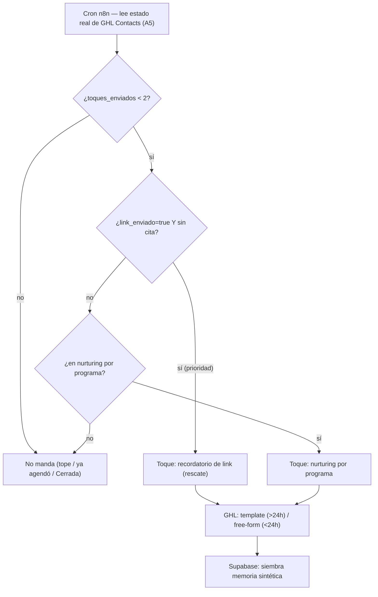

# 08 · n8n — despachador único de re-enganche (nurturing + rescate + outreach)

> ### 🔄 Estado a 2026-09-07 — 🟡 MOTOR CONSTRUIDO (falta el envío, gated en templates)
> **✅ `vtr-despachador-proactivo-v1` (`vrShEXQGGAo4FqAt`, INACTIVO):** motor de selección completo validado vs GHL real — 3 queries (booked `OP·Bot` + rescate `link_enviado=true` + nurturing `estado∈{Contestó,Interrumpida}` OR-group) → tope-2 null-safe + dedup + prioridad rescate>nurturing + exclusión "con cita" + recencia. **tope-2 = OK del cliente.** Nodos de envío/memoria/update `disabled` hasta tener templates.
> **✅ Barrido interrumpida `vtr-barrido-interrumpida-v1` (`LrJuzU7qDeELWiAl`)** y **✅ clasificador Cualificado `vtr-clasificador-postconv-v1` (`Xmyoewwa1W5gm1fy`)** construidos (ver `03` para el criterio).
> **⚠️ 2 findings para el go-live:** (1) `ultima_actividad` **null en históricos** → recencia inefectiva → ~1.000 candidatos rescate en la 1ª corrida → **falta política de históricos pre-cutover**; (2) exclusión "con cita" **= 0** hasta poblar `OP·Bot Venttur` con el estado de booking.
> **🔴 Falta para producción:** cablear el **envío por template** (gated `05`), carril nurturing en vivo, paginación completa. `ne`/`gt` sobre CF → 422 (por eso el nurturing va por OR-group de estado).

> **🟡 Riesgo medio-alto.** Hoy hay **4 mecanismos de re-enganche paralelos** que se pisan (~9 toques por contacto → 34 fallos de entrega en el Reporte la agencia 1). El cliente decidió **consolidarlos en un despachador único en n8n con tope global de 2 toques**. Este módulo reconstruye esa consolidación, corrige el **gate roto del nurturing**, y fija la política de reapertura ("Cerrada").
>
> **Para quién:** la agencia. **Prerequisito:** `02` (custom fields `link_enviado`/`toques_enviados`/`estado_conversacion`) + `05` (templates) + **sandbox A5** (query Contacts por custom field). **Referencia:** `09_nurturing_rescate_reengagement.md`.
>
> **Estimado:** 5-7 hs. Corroborado contra `wf-resumen-etiquetas-seguimientos.json` (30 nodos), `wf-rescate-post-link.json` (25), `wf-outreach-form-meta.json` (36), `wf-seguimiento-agenda.json` (6).

---

## 8.1 Los 4 mecanismos de hoy → 1 despachador

| Mecanismo | Workflow (nodos) | Disparo | Cadencia | Universo |
|---|---|---|---|---|
| **Outreach** (tri-toque) | `outreach` (36) — cron + Sheets | lead Meta Lead Ads | 0h/+24h/+72h | 460 outreach / 382 al toque 3 |
| **Rescate** (2 fases) | `rescate` (25) — 2 wait | agente manda `promo.venttur.com/…` | +45min/+24h | **715 link sin cita** |
| **Nurturing drip** | `resumen-etq-seg` (30) — +8h | +8h post-conversación | 0/1/3/5 días | gate roto → dispara de más |
| **Seguimiento agenda** | `seguimiento-agenda` (6) | link sin cita a 48h | +48h | **muerto** (nodo padre disabled) |

**Embudo:** 3.819 → 1.090 link enviado → **418 agendaron** (375 con link, 43 directo) → 126 asistieron. **Universo de rescate = 1.090 − 375 = 715.** El rescate y el outreach mueven la aguja; el nurturing drip y el seguimiento-agenda **se solapan** con el rescate (mismo objetivo: link sin cita).

---

## 8.2 El despachador único (reconstrucción n8n-first)

**Reglas:**
- **Un solo cron** lee el estado real de los Contacts de GHL (`link_enviado`, cita, `toques_enviados`, `estado_conversacion`, `programa`) — reemplaza los 4 disparos dispersos. **Depende de sandbox A5** (query por custom field); si falla, índice liviano en Postgres.
- **Tope global 2:** `toques_enviados < 2` contando **outreach + rescate + nurturing juntos** (hoy el techo real era ~9). 🔶 **PENDIENTE OK del cliente** (delegó en el Reporte, no firmó — `09 §8`).
- **Prioridad:** `link_enviado=true` sin cita → **recordatorio de link (rescate) primero**; solo si no aplica → nurturing por programa. 🔶 también pendiente de OK.
- **1 solo mensaje por ejecución** (no burst).
- **Siembra memoria sintética** en Supabase (sin cambios) para que el agente no re-salude cuando el lead responde.

> **Separación con los comerciales (`03`/`09 §2`):** el despachador mueve **solo el estado del bot** (Contact custom fields + el pipeline operativo `03 §2`). **No toca** los 20 pipelines comerciales.

---

## 8.3 El gate del nurturing — el fix central

Hoy el nodo `OpenAI` del `resumen-etq-seg` (Tarea 4) tiene una whitelist de "links para agendar" que **NO incluye** `promo.venttur.com/agendar-ema` (el link de Boarding/fallback) → todo lead que recibió ese link se clasifica como "nunca recibió link" (`No envio link?` = TRUE) → entra al drip genérico. Es el **64% del Hallazgo 2** (las `seg_dia_*_bs` que fallan).

🔧 **Fix (reconstrucción):** el gate deja de depender de la whitelist de strings del prompt LLM. Usa el **campo real `link_enviado`** (Contact custom, escrito determinísticamente por `wf-actualizar-link` cuando el output contiene `promo.venttur.com/`). Es el flag que `02 §2.3`/`03 §5` rutean como custom field (**NO etapa**, para que avanzar a "agendó" no lo pise).

- `link_enviado=true` + sin cita → **rescate**.
- `link_enviado=false` → **nurturing por programa**.
- Ambos sujetos al tope 2.

**Nodos afectados** (`resumen-etq-seg`): reemplazar la lógica de `No envio link?` / `No envio link? x2` (que hoy leen la salida del LLM) por lectura del `link_enviado` real.

---

## 8.4 Multi-programa por contexto — se descarta el `Switch`

Hoy el `Switch` del `resumen-etq-seg` tiene orden `Pathway > Summer > AA Familiar > Boarding > Gap Year` y dispara el primer match → orden que "no parece deliberado", y `Set programa_interes` **sobrescribe** `Programa interés` en cada corrida sin guarda (reclasifica conversaciones cerradas).

🔧 **Fix (`ronda-2 §6`):** *"el bot pregunta/sugiere según el contexto. No hay orden fijo."* → **el `Switch` de orden se descarta** (`00 §6`). El programa que gobierna el nurturing sale del **descubrimiento conversacional**, no de una prioridad hardcodeada. Y 🔧 **`Set programa_interes` NO sobrescribe** un lead ya clasificado (agregar guarda).

Los 6 sends por programa (`Boarding School`/`Pathway`/`Gap year`/`Año Académico`/`Summer Camp`/`Seguimiento Lead General`) → **Message Templates GHL** (`05`), disparados por API desde el despachador según el `programa_interes` del Contact.

**Otros fixes de nodo:** `Etiquetar Contacto` tiene el 🐛 bug tag `.variable` → corregir al recablear a GHL tags.

---

## 8.5 Política "Cerrada" (reapertura)

**`ronda-2 §2`:** un lead cerrado/perdido que vuelve a escribir → **el bot atiende normal**, con dos diferencias duras (vs el incidente de agosto):
- **NO se sobrescribe el programa** capturado.
- **NO se dispara ninguna secuencia** de nurturing por la reapertura.

En GHL: el Contact conserva `programa_interes` y estado; el inbound entra por Contact Reply → agente (`07`), pero el **despachador excluye** a los Contacts en estado terminal/cerrado de arrancar una cadencia nueva.

---

## 8.6 "Interrumpida" — 24h (operativo) vs ~5 días (reporte)

Son **dos cosas distintas** que hoy se confunden (`09 §6`):
- **Operativo (barrido `estado-interrumpida`, cada 1h):** marca `estado_conversacion='interrumpida'` a las **>24h** de silencio → deja de esperar en caliente; sirve al despachador. Se mantiene (ajustable).
- **Reporte:** "conversación no continuada" = **agotó la secuencia** sin responder (~5 días). Con el tope de 2, el agotamiento llega antes → el "~5 días" se ancla al **fin de la secuencia consolidada**, no a un timer fijo.

Conviven sin pisarse (uno operativo, uno de reporting). **Confirmar ambos umbrales con el cliente.**

---

## 8.7 Memoria sintética + Lead Score

- **Memoria sintética** (la siembran outreach/rescate/dispatcher en Supabase): se mantiene, apuntando a los **mismos `session_id`** (teléfono canónico con el fix MX de `06`/`07`) para no partir sesiones.
- **`Lead Score`/`Tipo lead`:** el cálculo vive **fuera de los 14 workflows** y no está localizado. Si el despachador los usa para priorizar → **relocalizar el cálculo a n8n**; si no → migran **congelados** (`02 §9.7`). Decisión pendiente.

---

## 8.8 Banderas y checkpoints

| Bandera | Estado |
|---|---|
| Tope global 2 + prioridad rescate>nurturing | 🔶 **PENDIENTE OK del cliente** |
| Query Contacts por custom field (cron) | 🟡 **sandbox A5: query por teléfono ✅, por custom field ✗ (400)** → el cron del despachador NO puede filtrar por CF con la sintaxis probada. **Resolver la sintaxis de filtro por CF, o usar el índice liviano en Postgres** (fallback ya diseñado) antes de construir este módulo. Búsqueda que sí anda: `POST /contacts/search` con `{"group":"AND","filters":[{field,operator:"contains",value}]}` + UA obligatorio |
| Cadencia temporal fina (a qué horas los 2 toques) | se cierra con el cliente |
| "Interrumpida" 24h vs ~5 días | confirmar ambos umbrales |
| `Lead Score`/`Tipo lead` congelado vs relocalizado | decisión pendiente |
| Landing `go.venttur.com/bs` repuntada (`09`) alimenta este despachador | dependencia |

✅ **Checkpoints de cierre:**
- [ ] Un solo cron/despachador leyendo estado de Contacts GHL (los 4 mecanismos consolidados).
- [ ] Tope global de 2 aplicado (con OK del cliente).
- [ ] Gate por `link_enviado` real (no whitelist LLM) — rescate vs nurturing.
- [ ] `Switch` de orden descartado; `programa_interes` con guarda anti-sobrescritura.
- [ ] Política Cerrada: excluye terminales de nueva cadencia.
- [ ] Barrido de interrumpida (24h) reconstruido sobre Contacts GHL.
- [ ] Memoria sintética con `session_id` canónico.

---

*Corroborado contra `resumen-etiquetas-seguimientos` (30 nodos: `OpenAI`, `Switch`, `No envio link?`×2, 6 sends por programa, `Set programa_interes`, `Etiquetar Contacto`), `rescate` (25), `outreach` (36), `seguimiento-agenda` (6, muerto). 2026-09-03.*
